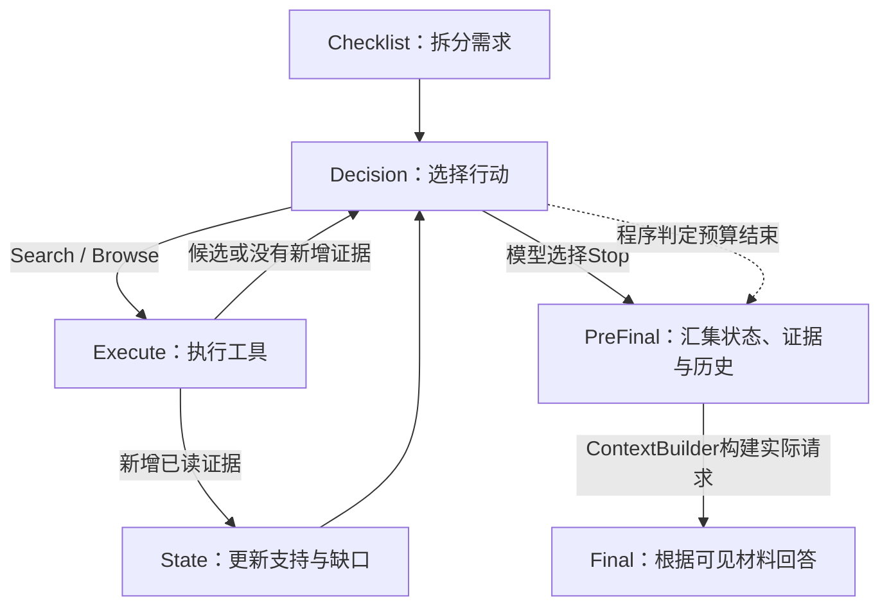

# 医学研究智能体 · Medical Research Agent

围绕医学问题中的证据缺口，自主搜索论文和网页、读取来源并记录未解决项，再把可追溯的材料交给答案生成环节。项目已经完成阶段SFT、独立Final对照、Process-GRPO与逐题评测闭环，用于研究和工程展示，不替代临床判断。

**当前主要探索版本三：Base → Process-SFT → Process-GRPO。** Process负责需求拆解、检索选择与证据判断；Final负责根据实际交付材料回答。两者是可分别控制参数的角色，可以共用同一基座。基座为`Qwen/Qwen3-8B`，采用bitsandbytes 4-bit NF4双重量化、BF16计算；Base表示不启用项目LoRA。[术语说明](versions/process_final_sft/glossary.md)

## 主要结果与当前选择

下表来自**跨基准验证评测 · HealthBench50＋MedBrowseComp50**：100题、四组共400条真实轨迹。四组只替换Process策略，采用相同运行配置，Final统一固定为Base；各组独立重新检索，得到的证据可以不同。

| 跨基准验证评测指标 | Base | Process-SFT | GRPO13 | GRPO25 |
|---|---:|---:|---:|---:|
| HealthBench实际证据交付覆盖 | 63.08% | 78.00% | 76.08% | **81.92%** |
| MedBrowseComp实际证据交付覆盖 | 4.50% | 10.00% | 7.17% | **13.17%** |
| 完全重复Search额外动作 | 31 | 1 | **0** | **0** |
| 重大或Process失败，去重题数 | 21 | 17 | **14** | **14** |
| Process失败 / 100 | 6 | 2 | **1** | **1** |
| Final失败 / 100 | **0** | **0** | 1 | 2 |

当前以**GRPO25作为证据交付主候选**，GRPO13保留为HealthBench答案指标对照。GRPO25对SFT的交付覆盖为22胜、11负、67平，Process质量值R为41胜、38负、21平；收益集中在证据交付和部分可靠性指标，逐题比较并非全面占优。

交付覆盖衡量适用材料覆盖多少原题内容点，不是医学答案准确率。完全重复Search可能命中缓存，也不等于重复API调用。全部答案Judge分、胜负、失败和统计边界见[跨基准验证完整报告](versions/process_final_sft/experiments/newbench_20261028/README.md)；[评测地图与指标](versions/process_final_sft/evaluation.md)解释三项评测的用途。

## 真实案例：交付与失败都能追溯

- **[Q45：浅表伤口护理](examples/version3_cases/Q45_grpo25/README.md)**：2次Search、4次Browse、4次State更新，实际交付覆盖100%。保留原始Final及0.2885的HealthBench答案分，展示“证据交付充分”与“答案仍有不足”的区别。
- **[Q98：多跳试验检索](examples/version3_cases/Q98_grpo25/README.md)**：定位到目标试验，后续两次Browse决策均因绑定3项需求而被拒绝，Process终止且没有Final。案例保留原始错误、已找到的材料和诊断依据。

两条均来自已有GRPO25真实记录，没有补搜或重新评分；完整英文原题、Checklist、动作、证据短摘录与State变化见[案例索引](examples/version3_cases/README.md)。

<a id="工程架构langgraph--react--mcp"></a>
<a id="当前完整问答流程"></a>

## 一次问答如何运行



模型负责拆需求、选行动、判断支持程度和综合回答；程序负责工具执行、格式与ID校验、预算、上下文和记录。**Search只返回候选；Browse产生新增已读证据后才调用State。** 模型Stop与程序预算终止分别记录，工程完成不代表医学质量通过。

PreFinal汇集完整包，ContextBuilder生成实际Final请求。完整问答使用该请求生成答案；Process-only采集另外保存固定输入快照后结束。参数冻结与输入快照固定是两种不同约束。[完整架构与执行机制](versions/process_final_sft/engineering.md)

<a id="从当前模型继续训练的完整路线"></a>

## 训练改了哪里

**参数更新主线：Process-SFT → Process-GRPO。Final-SFT是独立答案模块对照。**

Process-GRPO更新边界为：

```math
\theta_{\mathrm{Process}}\leftarrow\theta_{\mathrm{Process}}+\Delta\theta,
\qquad \theta_{\mathrm{Final}}=\theta_{\mathrm{Base}}\;\text{(fixed)}.
```

| 工作 | 输入与初始化 | 更新对象与产物 |
|---|---|---|
| [Process-SFT](versions/process_final_sft/process_sft.md) | 量化基座＋972题Teacher阶段轨迹 | Process LoRA；10,575阶段样本、1,322次更新 |
| [Process-GRPO](versions/process_final_sft/grpo.md) | 原972 Process LoRA＋100题×4轨迹及本地奖励 | 99个可用题组、25批更新；保留GRPO13／25，Final参数固定 |
| [Final-SFT独立对照](versions/process_final_sft/final_sft.md) | 同基座＋冻结Final输入与指定gold；500训练／100开发题 | 独立Final LoRA；比较1／1.5／2轮与Base Final |

在dev100固定输入对照的共同有效97题上，Base Final为77.06分，Final-SFT三个checkpoint为58.40／61.57／65.98分。因此当前问答和Process-GRPO保留Base Final；GRPO不加载Final-SFT checkpoint，Final-SFT训练不是其必经前置。[Final模块对照评测](versions/process_final_sft/experiments/final_sft_dev100/README.md)

GRPO在共同工程约束内学习相对更好的Process策略；同题优势、生成／训练概率校正、PPO式裁剪、轨迹归一化与恢复验收见[算法说明](versions/process_final_sft/grpo.md)。

<a id="源码与阅读入口"></a>

## 如何验证与深入阅读

不加载模型、不请求搜索或Judge的检查入口：

```bash
python -B run_pipeline.py check
python -B tools/check_public_architecture.py
python -B examples/test_version3_cases.py
python -B versions/process_final_sft/experiments/newbench_20261028/verify_results.py
```

| 要了解什么 | 入口 |
|---|---|
| 版本三的实验关系与资料地图 | [版本三概览](versions/process_final_sft/README.md) |
| 单题流程、共享机制、交接边界 | [完整架构](versions/process_final_sft/engineering.md) |
| 模型、量化、题集、预算与隔离 | [数据与实验设置](versions/process_final_sft/design.md) |
| 三项评测及评分定义 | [评测地图](versions/process_final_sft/evaluation.md) · [全部逐题记录](versions/process_final_sft/records.md) |
| 当前维护源码与冻结实验源码 | [当前源码入口](versions/process_final_sft/current/README.md) · [按功能定位](docs/code_navigation.md) |
| 概念、指标及公开范围 | [术语解释](versions/process_final_sft/glossary.md) · [部署输入](versions/process_final_sft/current/process_grpo_update/README.md#部署输入与适用范围) |

**公开复现分三层：** 基础检查不依赖私有数据；合成CPU测试需安装对应依赖；真实GPU训练与实验复现还需自有模型、轨迹、奖励及身份文件。批量原始答卷、gold、权重和凭据保留私有；真实案例按其页面说明公开有限原始摘录。

当前主线为**[版本三](versions/process_final_sft/README.md)**；历史探索保留为[版本一：单LoRA](versions/single_lora/README.md)与[版本二：双LoRA](versions/dual_lora/README.md)，对应[冻结历史检索](versions/legacy_retrieval/README.md)。各实验保持自己的执行身份，不混用配置和统计结论。

Apache-2.0；必要署名见[第三方声明](THIRD_PARTY_NOTICES.md)。模型与外部服务另受各自条款约束。
