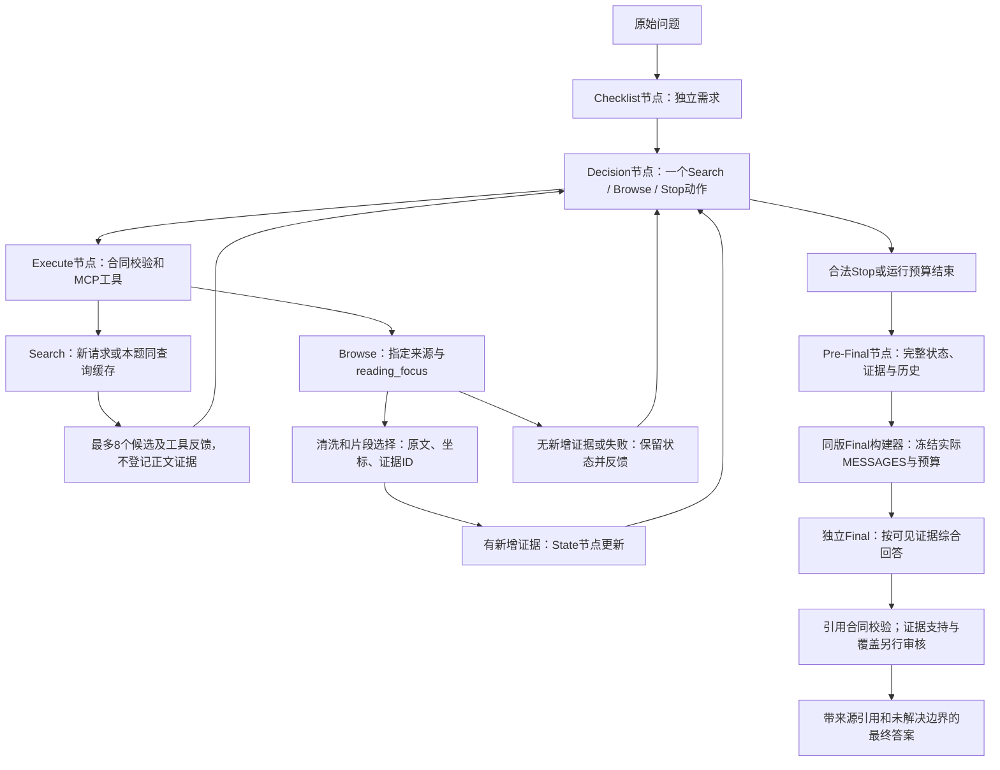
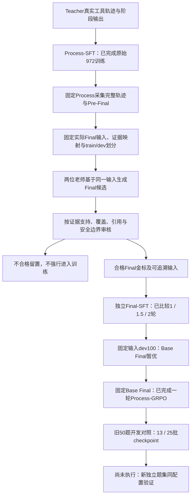
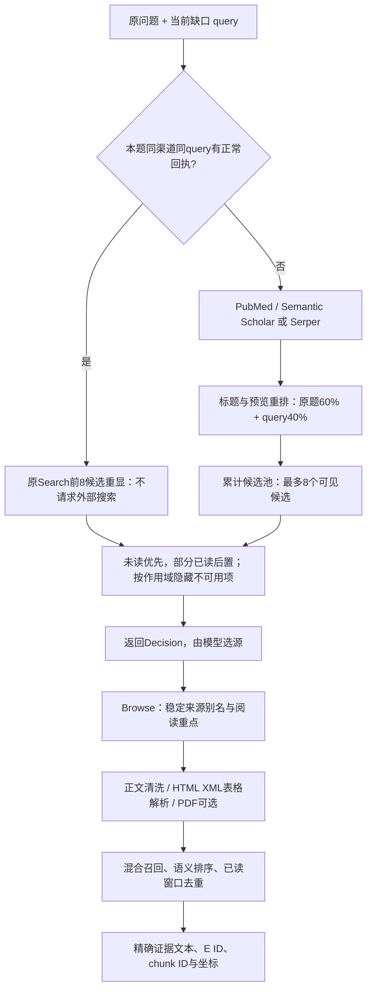

# 医学研究智能体 · Medical Research Agent

面向医学文献与网页资料的证据检索智能体。系统把问题拆成可独立核验的需求，围绕当前证据缺口动态搜索、读取来源、更新状态，再把可追溯的证据交给答案生成环节。

项目关注的不只是“搜到一个相关标题”，而是 **读到了什么、解决了哪个需求、还有什么没有证实**。用于研究，不替代临床判断。

**当前主线：Process-SFT获取证据 → 独立Final-SFT对照 → 冻结Base Final → Process-GRPO → 分开评测证据交付和最终答案。** 已完成一轮GRPO的13/25批checkpoint评测，见[版本三实验与逐题结果](versions/process_final_sft/experiments/process_grpo_20261026/README.md)；Final-SFT暂未胜过Base，见[dev100四组对照](versions/process_final_sft/experiments/final_sft_dev100/README.md)。

## 当前主线与历史探索

**当前主要探索版本三：将Process证据获取与Final答案综合分开训练、分开评测，再研究固定Final下的Process优化。** 版本一、二是此前的探索路线，保留用于说明演进与复现，不作为当前默认实现。

| 路线与定位 | 检索代码 |
|---|---|
| **[版本三：Process-SFT + Final-SFT](versions/process_final_sft/README.md)** · 当前主线 | [当前源码与检索](versions/process_final_sft/current/README.md) |
| [版本一：单LoRA](versions/single_lora/README.md) · 历史探索 | [冻结旧检索](versions/legacy_retrieval/README.md) |
| [版本二：双LoRA](versions/dual_lora/README.md) · 历史探索 | [冻结旧检索](versions/legacy_retrieval/README.md) |

版本目录区分已经执行的训练与待执行的研究计划。公开内容仅包含代码、合同、配置、方法说明与脱敏评分汇总，不包含私有训练题、完整采集记录、金标答案、模型权重或凭据。

## Base 模型与角色

**当前选用：`Qwen/Qwen3-8B`，以bitsandbytes 4-bit NF4双重量化加载，BF16计算；Process-SFT的LoRA参数保留FP32。** 这里的模型名是Qwen3-8B，量化是本项目加载配置，不另造一个官方量化模型仓库名称。

| 模型/量化项 | 当前具体配置 |
|---|---|
| 基座模型 | `Qwen/Qwen3-8B` |
| 量化实现 | Transformers `BitsAndBytesConfig` / bitsandbytes |
| 基座权重 | `load_in_4bit=True`，`bnb_4bit_quant_type="nf4"` |
| 双重量化 | `bnb_4bit_use_double_quant=True` |
| 量化计算类型 | `bnb_4bit_compute_dtype=torch.bfloat16` |
| Process训练 | NF4 QLoRA；量化基座冻结，FP32 LoRA参与更新 |

本仓库的 **Base** 指上述同一量化基座**不加载本项目adapter**的对照状态，不是另一个名为`Qwen3-8B-Base`的模型，也不表示FP16/BF16未量化对照。当前加载代码见[模型服务](versions/process_final_sft/current/serve_policy.py)，原972训练加载见[训练器](versions/process_final_sft/current/original972_training/train.py)。

当前运行采用非thinking阶段请求；上下文以项目部署合同为准：软线12,288、硬线15,000 tokens，包含输出及修正预留，而非单算输入。原始972训练仍保留其10,240-token历史合同，不用新预算追溯修改训练记录。

| 实验角色 | 模型与参数状态 |
|---|---|
| Base Process | Qwen3-8B / 4-bit NF4，无项目 LoRA；执行 Checklist / Decision / State / Stop |
| Base Final | 同一4-bit NF4基座，无项目 LoRA；冻结后综合Pre-Final，不是更大的替代模型 |
| Process-SFT | 同一4-bit NF4基座 + 原始972 Process LoRA checkpoint1322；不训练Final target |
| Final-SFT（已对照） | 同基座 + 独立Final LoRA，已训练1/1.5/2轮；dev100未胜Base，本轮GRPO不采用 |
| Process-GRPO | 从原972 SFT继续，只更新Process LoRA；保留13/25批，Final固定Base |
| 压缩兜底 | 同基座禁用Process LoRA，独立无状态请求；不另设自主检索Agent |
| Teacher / Grader | Process teacher、后续Final金标审核者与Qwen替代裁判分别登记；不混入Base对照 |

SFT 使用 NF4 QLoRA、BF16 compute、FP32 LoRA；在线 Process 与 Final 的实际加载精度、thinking及采样配置分别登记，不能只凭模型名称认定数值路径相同。文档统一称 Base；历史配置中的 `raw` profile、JSON键与文件名保留，确保旧结果可复现。

## 工程架构：LangGraph + ReAct + MCP

系统采用**单一Process策略模型 + 显式状态图 + 真实检索工具**。LangGraph负责阶段编排，ReAct描述“决策—执行—观察反馈—再决策”的交互方式，MCP提供工具调用边界；三者不是三个独立Agent。

| 工程层 | 当前实现与作用 |
|---|---|
| LangGraph节点编排 | `Checklist → Decision → Execute → State`循环，按状态路由至`Pre-Final`及可选`Final`；Search/Browse由Execute执行，Stop是Decision动作，不另设Stop模型节点 |
| ReAct式策略循环 | 模型围绕证据缺口选择Search、Browse或Stop；工具回执、候选、已读证据与State进入后续决策，不是固定“搜索一次就回答” |
| MCP工具封装 | FastMCP暴露`paper_search`、`web_search`、`browse`；桥接冻结检索后端，返回结构化Observation；历史排序属于Runtime辅助工具，不是模型自主动作 |
| 显式上下文与合同 | ContextBuilder为每次请求构建当步可见输入、计量token并处理预算；程序核验JSON、需求绑定、可见来源和证据ID，模型负责需求、选源及支持判断 |
| 持久化与审计 | 自有SQLite Store保存状态checkpoint、调用回执、事件及运行锁；结合原始文件与哈希导出，支持明确状态下的续跑，不把未知调用自动重试为成功 |

每次模型调用都由程序显式传入工作状态，不依赖服务端隐式聊天记忆。**节点化用于拆清输入、输出与错误边界，不表示增加了多个自主推理Agent，也不自动保证证据或医学结论正确。** Process与Final是可分别训练、切换adapter的角色，不要求部署为两套独立基座。

实现入口：[节点与路由](versions/process_final_sft/current/runtime/src/trainable_agent/engine.py) · [MCP工具](versions/process_final_sft/current/runtime/src/trainable_agent/tools.py) · [持久化](versions/process_final_sft/current/runtime/src/trainable_agent/storage.py) · [详细架构](docs/architecture.md)。

## 当前完整问答流程

Process负责“下一步需要什么证据”，Final负责“已有证据能支持怎样的回答”。两个模块共用基座、分开训练和核验；下面展示完整系统，而不是某一批采集任务的结束位置。



当前是一个模型策略循环，由LangGraph节点编排、MCP工具执行，属于ReAct式“决策—工具反馈—再决策”，不是多个模型轮流自主检索。程序不代替模型判断医学支持程度，也不要求预算内必须把每项都判成direct。

完整问答模式使用Base Final；Pre-final采集可在冻结输入处结束。本轮GRPO采集同时保存固定Base Final输出，但本地Process奖励评价的是实际交付材料与过程，Final不更新。独立Final-SFT已单独对照，未作为本轮答案模块；引用/语法核验不能代替医学质量审核。

评测结果与模型选择理由见[Base / SFT / GRPO13 / GRPO25](versions/process_final_sft/experiments/process_grpo_20261026/README.md)及[Final-SFT与Base对照](versions/process_final_sft/experiments/final_sft_dev100/README.md)；主页展示完整设计，逐题分数和错误放在版本三评测中。

## 从当前模型继续训练的完整路线



1. **冻结输入**：600题预划500 train / 100 dev，用原972 Process采集并保留失败与质量问题；实际Final输入与完整存档分开核验。
2. **制作金标并验证Final**：老师读取相同证据生成候选，使用指定gold训练独立Final LoRA；dev100对照中三个checkpoint均未超过Base Final，因此没有直接追加训练。
3. **固定Base Final更新Process**：另100道训练题各采4条轨迹，本地审核实际交付与过程，99个可用题组完成25批离线GRPO更新。
4. **分别评测内容与答案**：13/25批各重新运行旧50题，报告交付覆盖、State错误、完成率和HealthBench分。旧题用于开发，新独立题集验证尚未启动。

这里展示已经执行的依赖与当前验证边界；完整参数、分数和后续设计见[版本三](versions/process_final_sft/README.md)、[评测边界](versions/process_final_sft/evaluation.md)和[GRPO算法与后续设计](versions/process_final_sft/grpo.md)。

## 两条检索链路

论文和网页共用工具协议、候选池与证据交接，但使用适合各自内容的检索和正文处理路径。

| 环节 | 论文 | 网页 |
|---|---|---|
| 来源发现 | PubMed 与 Semantic Scholar | Serper 网页搜索 |
| Search 返回内容 | 标题、摘要及来源元数据；摘要不等于全文 | 标题、snippet 与 URL；预览不等于已读正文 |
| Search 语义排序 | 本地Cross-Encoder，论文路径采用MedCPT | 本地Cross-Encoder；实际模型路径由部署配置冻结 |
| 排序关注点 | 原问题 0.6 + 当前 query 0.4 | 原问题 0.6 + 当前 query 0.4；权威性不覆盖相关性 |
| Browse | 按可用来源读取摘要、正文或 PDF；访问失败有明确回执 | 访问探针、网页正文提取与结构清洗 |
| 片段选择 | 医学片段检索、语义重排、表格结构保留 | 正文清洗后混合召回与语义重排 |

语义模型不可用时，Search 模块保留原有可用排序并记录降级，不把模型加载失败伪装成“没有相关证据”。PDF 解析属于可选正文路径，不承诺每篇论文都能取得全文。



## 候选池：保留历史，不覆盖最新结果

当前可见窗口最多 **8 个候选**。首次搜索沿 Search 后端的返回顺序填充；之后最多先放 4 个最新候选，剩余位置从历史池按原问题的 MiniLM 相关性选择。历史不足时，用更多最新候选补齐。

新查询先沿后端顺序组装最新/历史窗口，不做第三次语义全局重排，再应用可用性和阅读状态的稳定分组：未读优先、已读但未明确耗尽的后置。显示顺序改变不重命名来源字母。候选池保存累计来源，可见窗口只是模型投影。

相同渠道、大小写与空白规范化后的相同query重显原Search缓存，不混入其他历史query的结果、不联网凑满8条，不作为非法Decision；仍消耗一次正常动作。模型可以从剩余候选选其他来源，也可以改变query或停止。明确耗尽或失败只按已知作用域隐藏，不删除原始历史或断言整篇论文没有证据。

## Checklist、State 与动态 Query

- Checklist通常2–5项，简单问题允许1项；复杂问题确有独立需求时可6–8项，schema硬上限8，不靠凑数拆分。
- Decision看原问题、全部Checklist/最新State、精简动作历史、反馈、预算、候选，以及最近一次新增证据的Browse正文和累计E索引；不反复塞入全部旧正文。论文允许医学关键词或Boolean检索式，网页允许聚焦短语，不强制英文完整句子。
- Prompt 要求不引入无关疾病、药物、年份或研究类型；这些是模型指导，不是后端已经证明的语义硬约束。
- Browse 只允许使用当前列出的来源 ID。标题相关不等于证据支持；导航、登录、广告和访问错误不能用于提升覆盖状态。
- State只在Browse新增证据后调用，能看到累计已打开证据、当前State、Checklist与新E ID，返回变更项 `missing / partial / direct`、证据ID、gap和conflict。`direct`不等于确定性、全部解决或医学正确。

每次Search/Browse显式绑定1–2个现有requirement_ids；Browse用可见来源字母，程序解析到原始source_id。来源字母、E证据ID和chunk_id不可互换。模型可切换缺口，不由程序强制下一步选哪条。当前节点与模块说明见[系统架构](docs/architecture.md)。

## 历史、预算和失败处理

历史是固定预算下的工作记忆，保存已发生的动作、工具结果摘要和状态变化；证据正文单独交接。历史不能引用未来阶段，也不能把失败尝试标成成功。最终状态以最新有效 State 为准。

每阶段使用真实chat模板/tokenizer动态计量完整请求：软线 **12,288**、硬线 **15,000** tokens；Checklist/State输出预留1,200，Decision（含Stop）400，Final 2,400，另计repair384与安全余量128。不是每部分各有15,000，也不是输入15,000后再追加输出。

超软线先清理确定性冗余、因式分解重复工程记录；仍不足才使用隔离模型抽取原文作最后兜底，Search预览与Browse正文不合并压缩。软目标未达但完整请求仍在硬线内可带审计继续；无法安全容纳才明确失败。不可声称有限预算能保证容纳任意长输入。

每次阶段准备的压缩模型调用上限12（含格式纠正），辅助请求自身限10,240 tokens；它与主阶段15,000硬线是不同请求，不是把二者相加为可用上下文。

工具预算：**6次正常动作 + 最多5次已识别环境失败豁免，actual上限11**；actual包含缓存动作，不等于外网请求次数。决策可恢复拒绝另有上限6，不显示剩余拒绝数字诱导策略。已接受重复Search由正常工具预算终止；格式/ID/State合同问题仍可失败。确定性JSON语法修复留审计，不猜ID、截断内容或医学结论，不处理Final引用幻觉。

## 证据交接与引用

保存两层Pre-Final：完整 `PRE_FINAL_PACKAGE.json`供审计；同版Final构建器准备的 `FINAL_REQUEST.json`、`MESSAGES.json` 和网页粘贴版 `TEACHER_INPUT.txt`供后续金标。它们绑定原问题、最新State、已读证据、来源、历史、精确token及输入哈希；实际模型可见投影不等于原始包全文。

原始证据快照、实际输入消息与各文件分别登记哈希；模型可见元数据投影不抹掉原始坐标或 provenance。原文选片/证据卡只是预算交接，不替代原出处，也不证明所选内容充分。

Final使用已打开的 `[E1]` 等证据ID，保留到source_id/chunk_id的映射；输出单个 `<answer>...</answer>`。无证据不能编造E1。引用存在、格式正确与句子被支持分别检查，不能互相替代。当前600题只冻结输入，不调用Final生成。见[引用与Final合同](docs/final_contract.md)。

## 源码与阅读入口

| 目录 / 文档 | 内容 |
|---|---|
| [版本三当前源码](versions/process_final_sft/current/README.md) | 节点、上下文、MCP、最新完整检索快照、原972训练器与采集导出 |
| [retrieval/](retrieval/README.md) | 既有工具后端快照，保留兼容入口；当前运行使用上方最新快照 |
| [retrieval/runtime/](retrieval/runtime/README.md) | 已公开的组件式Runtime快照，不冒充当前节点包 |
| [系统架构](docs/architecture.md) | 模块边界与证据生命周期 |
| [检索设计](docs/retrieval.md) | Search / Browse 与候选池细节 |
| [代码导航](docs/code_navigation.md) | 按功能定位实际源码 |
| [API 配置](docs/apis.md) | 服务用途与变量名；不含真实密钥 |
| [Codex CLI 轨迹采集](docs/codex_cli_collection.md) | Teacher 如何通过项目真实工具生成阶段轨迹与历史 |

## SFT 的共同输入合同与版本差异

一条完整工具轨迹拆成多个阶段样本：**阶段开始时真实可见的输入 → 当前阶段 teacher completion**。输入包含原题、预算内因果历史、最新有效 State、候选及可见证据；历史并非另一条需要生成的 target。只对当前 completion 计算 next-token CE，问题、Prompt、历史、工具 Observation 和证据不计 loss。被 Runtime 拒绝的错误输出保留溯源，但不自动作为正监督。

共同的是completion-only和真实输入合同，**loss归一化不跨版本混用**：版本一、二保留各自说明；原始972 Process训练在effective batch内按有效target-token总数归一，Checklist/Decision/State权重均1。Stop是Decision目标，程序Pre-Final不训练，Final目标为0；不把新的推理预算、程序修复或后续Final金标追溯写进原训练样本。

“没有固定最终答案金标”不等于“没有监督”：Process 使用 teacher 的 Checklist、工具动作和 State 等阶段目标；独立 Final 使用按实际 Pre-Final 审核的 gold answer。HealthBench 又有官方 rubric，不能称为无评测标准的题集。

共同的LoRA参数化为：

```math
W_{\mathrm{eff}}=W_0+\frac{\alpha}{r}BA,\qquad
W_0\ \text{frozen},\quad A,B\ \text{trainable}.
```

其中 $r$ 为adapter rank，$A$、$B$ 为低秩矩阵。当前completion的监督mask为 $m_{it}$：target为1，其余为0。共同CE项为：

```math
\ell_{it}=-m_{it}\log\pi_\theta(y_{it}\mid x_i,y_{i,\lt t}).
```

如何聚合这些CE项，以及阶段权重、GRPO优势与策略目标，分别见[单LoRA公式](versions/single_lora/README.md#sft与grpo公式)、[双LoRA计划公式](versions/dual_lora/README.md#计划算法与公式)、[Process与Final边界](versions/process_final_sft/README.md)、[本轮Process-GRPO公式](versions/process_final_sft/experiments/process_grpo_20261026/training.md)。

原始972题、10575阶段样本产生Process checkpoint1322；600题固定500 train/100 dev用于独立Final训练与对照。此后完成100题×4条Process-GRPO轨迹、99组25批更新，并完成旧50题的新GRPO13/25评测。Base/SFT历史与新GRPO共200条Process、dev100共400条Final均有逐题记录；无证据、State误读和失败保留，不以完成运行代替质量通过。

后续设计与历史计划分别标注，不将尚未执行的独立验证、消融或新一轮训练写成结果。见[版本三](versions/process_final_sft/README.md)、[评测边界](versions/process_final_sft/evaluation.md)和[GRPO后续设计](versions/process_final_sft/grpo.md)。

Apache-2.0；必要署名见 [第三方声明](THIRD_PARTY_NOTICES.md)。模型与外部服务另受各自条款约束。
