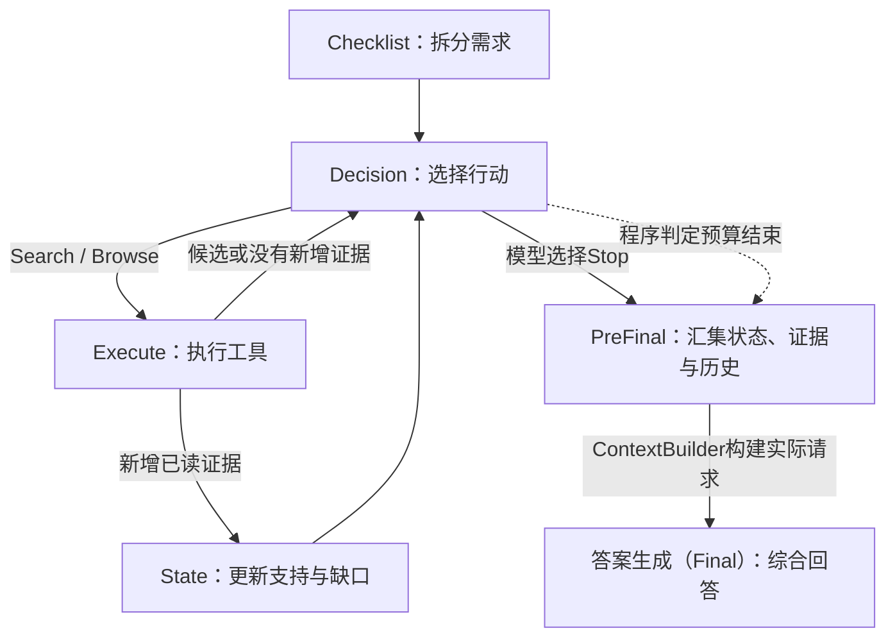

# 医学研究智能体 · Medical Research Agent

基于`Qwen/Qwen3-8B`的医学证据检索Agent：围绕问题缺口搜索论文和网页、读取来源并记录未解决项，再把可追溯的材料交给答案生成环节。用于研究和工程展示，不替代临床判断。

**当前主要探索版本三：Base → Process-SFT → Process-GRPO。** 检索与证据整理策略（Process）负责拆需求、选工具和判断证据；答案生成模块（Final）接收原问题和实际交付材料，综合回答，并按可用证据给出引用和限制。项目已完成Process训练、答案模块的单独微调对照与逐题评测；模型配置见[数据与实验设置](versions/process_final_sft/design.md)。

## 主要结果与当前选择

下表来自**跨基准验证评测 · HealthBench50＋MedBrowseComp50**：100题、四组共400条真实轨迹。四组只替换Process检索策略，都由同一Qwen3-8B基座配置生成答案（Base Final），生成答案时不启用本项目训练得到的适配器。**固定的是答案模块参数；各组读到的材料不同，答案仍可能不同。**

Base表示未启用本项目训练参数的对照；GRPO13／25分别是完成第13／25个更新批次后的Process checkpoint，数字不是训练轮数。

| 跨基准验证评测指标 | Base | Process-SFT | GRPO13 | GRPO25 |
|---|---:|---:|---:|---:|
| HealthBench核心答案正确率 / 50 | 52% | 54% | **60%** | 52% |
| HealthBench必要信息齐全率 / 50 | 30% | 44% | 46% | **50%** |
| MedBrowseComp核心答案正确率 / 50 | 28% | **38%** | 32% | **38%** |
| 完全重复Search额外动作 | 31 | 1 | **0** | **0** |
| 重大或Process失败，去重题数 | 21 | 17 | **14** | **14** |
| Process失败 / 100 | 6 | 2 | **1** | **1** |
| 答案生成失败 / 100 | **0** | **0** | 1 | 2 |

**Base→SFT→GRPO的改进在HB上同时体现为核心答题与信息交付：** GRPO13核心答案正确率60%，高于SFT的54%与Base的52%；GRPO25必要信息齐全率50%，高于SFT的44%与Base的30%。当前以GRPO25作为证据交付主候选，GRPO13保留为HB答案指标对照。MB上GRPO25与SFT同为38%；两个checkpoint各有侧重，不合并成一个模型的成绩。

核心答案准确率按原题核心结论／字段是否正确记0或1，失败保留，分母固定50题；必要信息齐全率看实际PreFinal是否足以支持全部必要内容，材料齐全不保证最终回答正确。MB涉及试验→药物→FDA等精确多跳，四组共同受6次正常工具动作预算约束，成绩结合任务要求与具体缺口阅读。[准确率标准、MB任务边界与逐题依据](versions/process_final_sft/experiments/newbench_20261028/accuracy.md)；原Judge分、覆盖、胜负和失败保留于[完整报告](versions/process_final_sft/experiments/newbench_20261028/README.md)。

## 真实案例：交付与失败都能追溯

- **[Q45：浅表伤口护理](examples/version3_cases/Q45_grpo25/README.md)**：2次Search、4次Browse、4次State更新，实际交付覆盖100%。保留模型生成的原始答案及0.2885的HealthBench答案分，展示“证据交付充分”与“答案仍有不足”的区别。
- **[Q98：多跳试验检索](examples/version3_cases/Q98_grpo25/README.md)**：定位到目标试验，后续两次Browse决策均因绑定3项需求而被拒绝，Process终止，未进入答案生成阶段。案例保留原始错误、已找到的材料和诊断依据。

两条均来自已有GRPO25真实记录，没有补搜或重新评分；完整英文原题、Checklist、动作、证据短摘录与State变化见[案例索引](examples/version3_cases/README.md)。

<a id="工程架构langgraph--react--mcp"></a>
<a id="当前完整问答流程"></a>

## 一次问答如何运行



模型负责拆需求、选行动、判断支持程度和综合回答；程序负责工具执行、格式与ID校验、预算、上下文和记录。**Search只返回候选；Browse产生新增已读证据后才调用State。** 模型Stop与程序预算终止分别记录，工程完成不代表医学质量通过。

答案生成前的交接阶段（PreFinal）汇集完整材料包，ContextBuilder再按预算构建答案模块实际能看到的请求。完整问答继续生成答案；只采集检索过程时，可保存这份实际请求快照后结束。[完整架构与执行机制](versions/process_final_sft/engineering.md)

<a id="从当前模型继续训练的完整路线"></a>

## 训练改了哪里

**参数更新主线：Process-SFT → Process-GRPO。** 我们还单独测试过答案生成模块的监督微调（Final-SFT），用相同证据输入比较微调前后的答题表现。

Process-GRPO更新边界为：

```math
\theta_{\mathrm{Process}}\leftarrow\theta_{\mathrm{Process}}+\Delta\theta,
\qquad \theta_{\mathrm{Final}}=\theta_{\mathrm{Base}}\;\text{(fixed)}.
```

| 工作 | 输入与初始化 | 更新对象与产物 |
|---|---|---|
| [Process-SFT](versions/process_final_sft/process_sft.md) | 量化基座＋972题Teacher阶段轨迹 | Process LoRA；10,575阶段样本、1,322次更新 |
| [Process-GRPO](versions/process_final_sft/grpo.md) | 原972 Process LoRA＋100题×4轨迹及本地奖励 | 99个可用题组、25批更新；保留GRPO13／25，答案模块参数不更新 |
| [答案模块SFT对照（Final-SFT）](versions/process_final_sft/final_sft.md) | 同基座＋固定答案输入快照与指定gold；500训练／100开发题 | 单独训练答案模块LoRA；比较1／1.5／2轮与基座答案生成器 |

在dev100固定输入对照的共同有效97题上，基座答案生成器（Base Final）为77.06分，答案模块SFT三个checkpoint为58.40／61.57／65.98分。因此当前采用基座模型生成答案；Process-GRPO从原972 Process权重继续训练，答案模块参数不参与该更新。[Final模块对照评测](versions/process_final_sft/experiments/final_sft_dev100/README.md)

GRPO在共同工程约束内学习相对更好的Process策略；同题优势、生成／训练概率校正、PPO式裁剪、轨迹归一化与恢复验收见[算法说明](versions/process_final_sft/grpo.md)。

<a id="源码与阅读入口"></a>

## 如何验证与深入阅读

不加载模型、不请求搜索或Judge的检查入口：

```bash
python -B run_pipeline.py check
python -B tools/check_public_architecture.py
python -B examples/test_version3_cases.py
python -B versions/process_final_sft/experiments/newbench_20261028/verify_results.py
```

| 要了解什么 | 入口 |
|---|---|
| 版本三的实验关系与资料地图 | [版本三概览](versions/process_final_sft/README.md) |
| 单题流程、共享机制、交接边界 | [完整架构](versions/process_final_sft/engineering.md) |
| 模型、量化、题集、预算与隔离 | [数据与实验设置](versions/process_final_sft/design.md) |
| 三项评测及评分定义 | [评测地图](versions/process_final_sft/evaluation.md) · [全部逐题记录](versions/process_final_sft/records.md) |
| 当前维护源码与冻结实验源码 | [当前源码入口](versions/process_final_sft/current/README.md) · [按功能定位](docs/code_navigation.md) |
| 概念、指标及公开范围 | [术语解释](versions/process_final_sft/glossary.md) · [部署输入](versions/process_final_sft/current/process_grpo_update/README.md#部署输入与适用范围) |

**公开复现分三层：** 基础检查不依赖私有数据；合成CPU测试需安装对应依赖；真实GPU训练与实验复现还需自有模型、轨迹、奖励及身份文件。批量原始答卷、gold、权重和凭据保留私有；真实案例按其页面说明公开有限原始摘录。

当前主线为[版本三](versions/process_final_sft/README.md)；历史探索保留为[版本一：单LoRA](versions/single_lora/README.md)与[版本二：双LoRA](versions/dual_lora/README.md)，对应[冻结历史检索](versions/legacy_retrieval/README.md)。各实验保持自己的执行身份，不混用配置和统计结论。

Apache-2.0 · [代码来源与许可](THIRD_PARTY_NOTICES.md)。依赖、模型与外部服务遵循各自条款。
