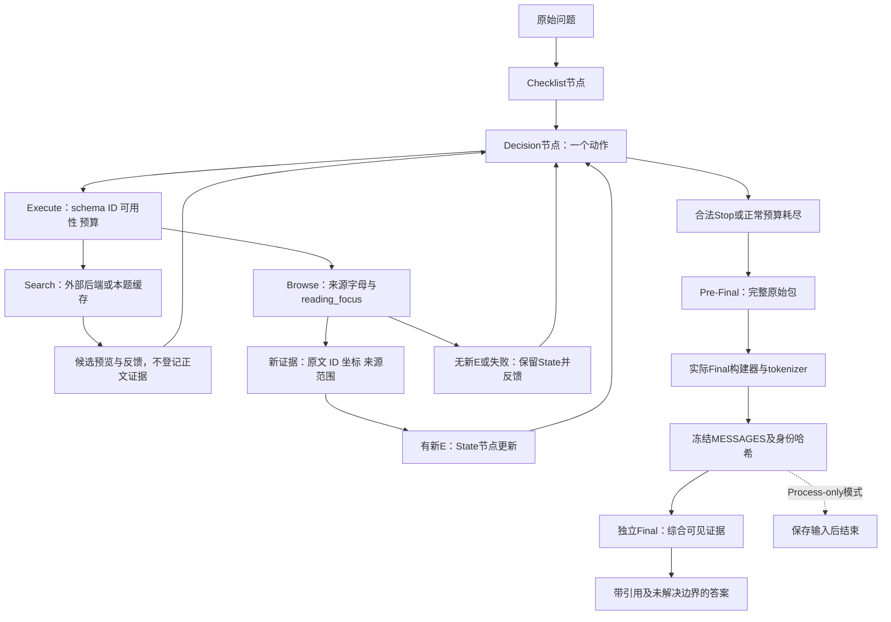

# 当前工程架构

[首页](../README.md) · [逐步工程设计](../versions/process_final_sft/engineering.md) · [检索机制](retrieval.md) · [版本三](../versions/process_final_sft/README.md)

## 一个策略循环，显式节点与工具边界

Process是单一模型策略，由LangGraph的Checklist、Decision、Execute、State、Pre-Final及可选Final节点编排。MCP工具实际执行Search/Browse，不是第二个自主Agent另行搜索；节点化不等于多Agent。每个模型请求没有隐式聊天记忆，输入由ContextBuilder从checkpoint显式构建。

这种设计将小模型的生成集中在需求拆解、动作选择和证据判断上。查网页、解析文档、记录来源、计算预算及验证引用由工具和程序承担，既保留围绕缺口调整路线的灵活性，也让每次选择有可追溯的执行结果。完整问答的主路径是Process取得证据后交给独立Final；仅采集Pre-final是同一流程的一个运行模式。

程序负责格式、身份、因果顺序、计量、确定性投影与审计；模型负责拆需求、query/reading_focus、选源、支持判断及停止理由。程序不代替模型修改医学内容，不保证每项解决或总能获得可读来源。sufficient是策略理由，不是医学认证。

| 组成 | 在系统中的职责 | 为什么保留这一边界 |
|---|---|---|
| LangGraph | 编排节点、条件路由和状态传递 | 固定执行次序与可恢复位置，让失败能够定位到具体阶段 |
| ReAct式循环 | Decision根据工具观察和缺口继续选择动作 | 允许换query、换来源或继续读同来源的新片段 |
| MCP与检索worker | 接收结构化工具请求，执行真实Search/Browse | 将外部访问与策略生成分开，统一回执和来源身份 |
| ContextBuilder与合同 | 构建当步输入，核验字段、R/E ID及预算 | 控制上下文规模并保持证据因果关系 |
| Process / Final角色 | 前者获取和整理证据，后者综合实际交付材料 | 可以分别评价过程与答案，明确收益来自哪个环节 |

节点、工具、模型角色是三个不同维度。一个Process策略可以经过多个节点和多次模型调用；Base、SFT与GRPO是该策略的不同参数状态，不是同题运行时互相讨论的三个Agent。

## 各阶段能看到什么

| 阶段 | 当前输入与输出 |
|---|---|
| Checklist | 原问题→通常2–5条完整需求，简单可1条，硬上限8；程序分配R ID |
| Decision | 原题、全部Checklist/最新State、当前目标、候选、精简历史、反馈、预算、累计E索引及最近有效Browse正文→一个Search/Browse/Stop |
| Search | 绑定1–2个R ID、channel和query；返回最多8个可见候选，不把预览当证据 |
| Browse | 绑定1–2个R ID、可见来源字母与阅读重点；一次最多3片段，不表示全文读完 |
| State | 累计已打开证据、当前State、Checklist、新E ID、历史与反馈；只在新证据后调用，返回变更项 |
| Pre-Final | 程序归档当前状态、全部原始证据、来源、历史和未解决项，不是模型目标 |
| Final输入冻结 | 同版构建器准备真实消息，必要时安全投影/压缩，不调用答案生成 |
| Final | 原题与实际交付的证据/State→综合答案；输出格式与引用ID由程序核验，支持程度另行审核 |

最近Browse正文在后续Search/空读后可能继续保留，但标注原轮次，不伪装成新结果。更早正文在Decision主要是索引，State/Final使用各自累计证据输入。State为可错的工作状态：missing/partial/direct、evidence_ids、gap和conflict；direct不等于确定性或全部覆盖。

## 身份与证据

来源字母稳定映射到PMID/S2/WEB source_id，显示排序变化不重分配字母；E1等是已打开证据ID；chunk_id与原始文本区间/哈希标识实际片段。三者不可互换。Search候选不自动获得可引用E。同篇可能有未读窗口，不因“同一篇”就拦截；重复片段不冒充新增证据。

## 上下文与失败

软线12,288、硬线15,000是每次完整请求的总预算，含输出、repair384和安全余量128。确定性去冗余优先，隔离模型原文抽取最后兜底，Search预览与Browse正文不合并压缩。原题、State和历史不能被证据抽取器任意改写；原始数据独立留档。超过软线但仍在硬线内可按预算策略带审计继续，不能安全容纳则失败。

Checklist/Decision/State的确定性JSON修复只处理明确语法，不猜ID、缺失语义或医学结论；原response、token/logprob和修复事件保留。标准SFT导出不把程序修复目标冒充模型原生合法输出。可恢复动作不可用错误可返回Decision，拒绝额度耗尽可降级；其他schema/State/上下文/工程失败仍单列，降级不能算正常。

## 双层Pre-Final

完整原包供审计，实际MESSAGES才是后续两位老师共用、Final训练绑定的冻结输入。金标只能由这些可见证据支持，不能额外联网补事实或换packing沿用旧金标。无证据、乱码、State错误及其他可疑记录留置，结构通过不自动放行训练。

## Base、SFT与GRPO怎样作用于同一个流程

Base提供未加载项目adapter的策略对照；Process-SFT通过真实阶段目标学习需求、动作与State协议；Process-GRPO继续优化同一Process LoRA，让同题轨迹中证据交付更有效、重大错误更少的选择得到相对更高权重。Final保持固定Base角色，便于把证据获取的变化与答案模块参数变化分开观察。

| 场景 | 同一题运行多少条 | 结果如何使用 |
|---|---|---|
| 本轮GRPO训练数据采集 | 同一策略采4条rollout | 四条共用内容点，审核实际Pre-final交付与过程，计算同题相对优势 |
| 离线更新 | 使用已封存轨迹，不重新调用工具 | 只更新Process策略token；工具返回、程序输出及Final不计入策略目标 |
| 四组benchmark比较 | Base、SFT、GRPO13、GRPO25各自重新运行一条 | 对比不同策略的真实轨迹、失败、证据交付和固定Final答案 |
| 单次完整问答 | 一条Process轨迹后接Final | 不要求先生成四份再挑最好一份，也不依赖在线裁判评分 |

四条rollout用于构造训练中的相对信号，不能把它理解成线上必须付出四倍检索成本。GRPO13、GRPO25表示第13与25个更新批次的checkpoint，不是13轮或25轮训练；算法、概率校正与恢复验收见[Process-GRPO](../versions/process_final_sft/grpo.md)。

## 工程约束如何支持策略比较

缓存、候选可用性、工具预算、上下文预算和证据ID校验为各组提供一致执行边界。它们防止重复网络请求和无界执行；GRPO学习的是在这些共同约束内如何选动作、使用证据和更新State，工程保护不只向GRPO开放。

本批跨基准验证100题中，完全重复Search额外动作由Base的31、SFT的1降至两个GRPO的0；重大或Process失败去重题数为21、17、14、14。GRPO25的实际交付覆盖在两个题集均最高，因此作为Process交付/可靠性主候选；GRPO13保留为HealthBench答案指标对照。该改进方向支持Base→SFT→GRPO路线，具体checkpoint仍按相应指标选择，逐题胜负和全部失败见[同配置四组结果](../versions/process_final_sft/experiments/newbench_20261028/README.md)。

## 持久化与恢复的边界

SQLite Store保存策略状态、checkpoint和调用记录；worker操作回执保存工具执行身份与结果哈希。两者分工保证“策略知道自己到了哪一步”和“工具知道哪些来源已实际返回”能够相互核对。worker重启时，从自身已完成且校验通过的Search回执恢复来源映射，使已有WEB、PMID和S2编号继续用于Browse，不新增隐式搜索。

恢复不会把未完成、状态未知或校验失败的操作推定为成功。完整回执、失败尝试和来源原文独立保留，当前可选集变化不会抹去历史。源码与具体限制见[worker来源连续性](../versions/process_final_sft/engineering.md#12-worker与来源回执保持中断前后的引用连续)。

当前模块为[公开trainable_agent](../versions/process_final_sft/current/runtime/src/trainable_agent)下的engine、contracts、context、search_cache、model_json、storage、tools、training及context_processing；[批量采集/冻结入口](../versions/process_final_sft/current/README.md)位于current目录。源码带原始/发布身份，不包含私有部署数据，见[代码导航](code_navigation.md)。版本一、二及后续计划不由本页改写。
