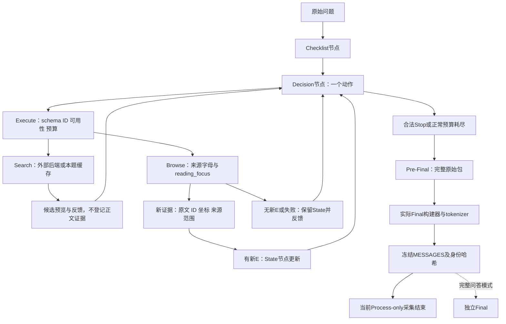

# 当前工程架构

[首页](../README.md) · [检索机制](retrieval.md) · [版本三](../versions/process_final_sft/README.md)

## 一个策略循环，显式节点与工具边界

Process是单一模型策略，由LangGraph的Checklist、Decision、Execute、State、Pre-Final及可选Final节点编排。MCP工具实际执行Search/Browse，不是第二个自主Agent另行搜索；节点化不等于多Agent。每个模型请求没有隐式聊天记忆，输入由ContextBuilder从checkpoint显式构建。

程序负责格式、身份、因果顺序、计量、确定性投影与审计；模型负责拆需求、query/reading_focus、选源、支持判断及停止理由。程序不代替模型修改医学内容，不保证每项解决或总能获得可读来源。sufficient是策略理由，不是医学认证。

## 各阶段能看到什么

| 阶段 | 当前输入与输出 |
|---|---|
| Checklist | 原问题→通常2–5条完整需求，简单可1条，硬上限8；程序分配R ID |
| Decision | 原题、全部Checklist/最新State、当前目标、候选、精简历史、反馈、预算、累计E索引及最近有效Browse正文→一个Search/Browse/Stop |
| Search | 绑定1–2个R ID、channel和query；返回最多8个可见候选，不把预览当证据 |
| Browse | 绑定1–2个R ID、可见来源字母与阅读重点；一次最多3片段，不表示全文读完 |
| State | 累计已打开证据、当前State、Checklist、新E ID、历史与反馈；只在新证据后调用，返回变更项 |
| Pre-Final | 程序归档当前状态、全部原始证据、来源、历史和未解决项，不是模型目标 |
| Final输入冻结 | 同版构建器准备真实消息，必要时安全投影/压缩，不调用答案生成 |

最近Browse正文在后续Search/空读后可能继续保留，但标注原轮次，不伪装成新结果。更早正文在Decision主要是索引，State/Final使用各自累计证据输入。State为可错的工作状态：missing/partial/direct、evidence_ids、gap和conflict；direct不等于确定性或全部覆盖。

## 身份与证据

来源字母稳定映射到PMID/S2/WEB source_id，显示排序变化不重分配字母；E1等是已打开证据ID；chunk_id与原始文本区间/哈希标识实际片段。三者不可互换。Search候选不自动获得可引用E。同篇可能有未读窗口，不因“同一篇”就拦截；重复片段不冒充新增证据。

## 上下文与失败

软线12,288、硬线15,000是每次完整请求的总预算，含输出、repair384和安全余量128。确定性去冗余优先，隔离模型原文抽取最后兜底，Search预览与Browse正文不合并压缩。原题、State和历史不能被证据抽取器任意改写；原始数据独立留档。软线未达但硬线内可带审计继续，不能安全容纳则失败。

Checklist/Decision/State的确定性JSON修复只处理明确语法，不猜ID、缺失语义或医学结论；原response、token/logprob和修复事件保留。标准SFT导出不把程序修复目标冒充模型原生合法输出。可恢复动作不可用错误可返回Decision，拒绝额度耗尽可降级；其他schema/State/上下文/工程失败仍单列，降级不能算正常。

## 双层Pre-Final

完整原包供审计，实际MESSAGES才是后续两位老师共用、Final训练绑定的冻结输入。金标只能由这些可见证据支持，不能额外联网补事实或换packing沿用旧金标。无证据、乱码、State错误及其他可疑记录留置，结构通过不自动放行训练。

当前模块为[公开trainable_agent](../versions/process_final_sft/current/runtime/src/trainable_agent)下的engine、contracts、context、search_cache、model_json、storage、tools、training及context_processing；[批量采集/冻结入口](../versions/process_final_sft/current/README.md)位于current目录。源码带原始/发布身份，不包含私有部署数据，见[代码导航](code_navigation.md)。版本一、二及后续计划不由本页改写。
