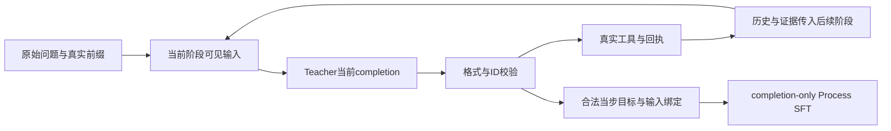

# Teacher轨迹与Pre-Final采集合同

[首页](../README.md) · [版本三](../versions/process_final_sft/README.md) · [Final输入合同](final_contract.md)

## 两类采集，不混为同一任务

| 任务 | 谁生成阶段输出 | 当前用途 |
|---|---|---|
| 原始972 Teacher轨迹 | Teacher提出Checklist、Decision/Stop、State，项目Runtime执行真实工具 | 拆成10,575条带真实可见历史的Process SFT目标 |
| 当前600题Pre-Final | 已训练原始972 Process模型，运行当前冻结节点/检索工程 | 提前500 train/100 dev，全部只到Pre-Final并冻结实际Final输入 |

Teacher不能在项目之外搜索后编写假Observation。真实工具调用、失败、证据、阶段输入和原始输出均保留。原始972训练使用当时实际messages；参考Runtime代码不冒充Teacher完整冻结源码，当前缓存/预算/JSON修复也不追溯改写旧训练记录。

## 原始Process训练的历史合同

972题共Checklist972、Decision6143、State3460；Decision包含Search2052、Browse3989、Stop102。其余结束由实际预算/程序状态判定，不给每条轨迹捏造一个Stop。8631条样本具有非空先前动作历史，不要求第一步凭空有历史。Final目标为0，Pre-Final由程序生成不训练；原导出排除50条被拒目标。当前程序语法修复和语义待审机制不追溯改成旧样本已有字段，也不把被修复文本当模型天然正确输出。

逐步SFT输入是“原问题、当前状态、真实因果历史和可见来源/证据→当步合法输出”，不是没有历史的孤立动作，也不是监督整条历史中的工具文本。输入及工具mask，错误动作不作为正target；后续输入不能看未来State、Final或评分。

## 当前600题的执行流程

1. 冻结600题文本、500/100划分、近似/同源分组、源码/配置和模型身份。来源与类别仅审计，模型只看question，不给DOI、答案或split提示。
2. 在计算节点使用原始972 checkpoint1322、NF4加载同基座；Process温度1，原文抽取兜底禁用LoRA、温度0.1。不会调用Teacher、Final或Judge生成。
3. LangGraph依次执行Checklist、Decision、Execute、必要时State，再回Decision。Search命中本题正常缓存可重显；Browse只有新E才调用State。
4. 合法Stop或正常预算耗尽后由Pre-Final节点归档。原始完整包与真实Final构建器冻结的MESSAGES分开保存，绑定来源/证据、历史、token和文件哈希。
5. 先三题pilot，人工允许后全量。同WORK跳过已记录完成attempt，包括失败；未知请求或pending/lease留待对账，不盲目重放、清lease或改run-id绕过。
6. 一致性导出完整轨迹、失败、SQLite在线备份、冻结输入和split；逐文件哈希并扫描凭据泄漏，不打包模型或密钥。

原始证据、State和历史不因冻结输入的预算投影改变。压缩兜底可能有真实辅助模型调用，但不生成Final；不能把纯程序fixture、已有记录重放或输入冻结当新的完整模型轨迹。

## 采集验收与质量边界

采集检查区分Process完成、实际Final输入完整、token预算通过和语义质量审核。pilot用于核验真实链路与导出，完整数据仍逐条检查；结构检查不能代替乱码、范围和State语义审核。已完成数据、Final对照及GRPO结果见[版本三实验](../versions/process_final_sft/README.md)，不以pilot状态替代全量结论。

正常、降级、Process失败、无证据、Final packing失败及语义可疑分开记录。程序JSON修复只改可确定语法，不替模型修医学含义；原坏输出和修复事件不抹去。Final金标仅由同一冻结可见证据支持，两位老师不能偷偷补充外部内容；不合格就留置，不按预定数量强行补齐。

## 源码与运行身份

当前模块入口为src/trainable_agent和packaging/prefinal600；[代码导航](code_navigation.md)区分实际冻结包与公开的既有组件。公开仓库不附私有题集、完整captures、运行日志、模型权重、CLI认证或集群环境。具体依赖、源码字节哈希与模型/请求身份由各运行包记录，不以目录名或某次本地成功替代服务器实测。

本页只更新已实现采集/导出合同；版本一、二及后续训练、评测、GRPO计划不改。
