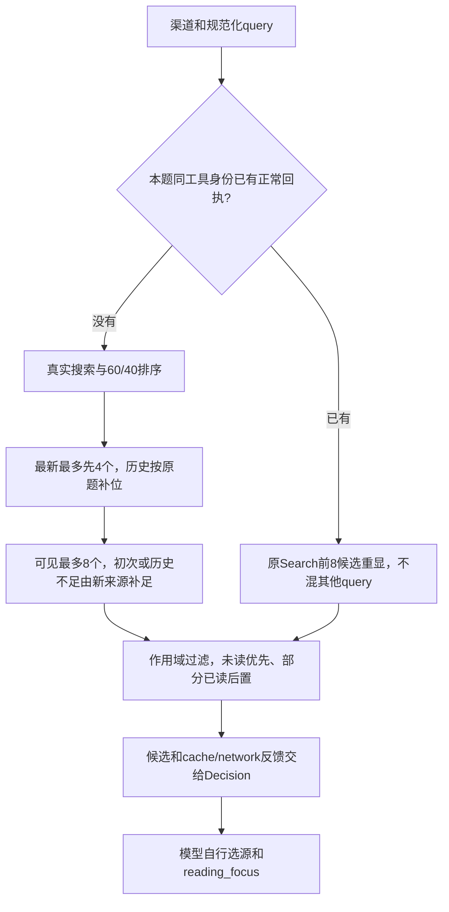

# 当前检索设计

[工程架构](architecture.md) · [首页](../README.md)

## Search发现来源，Browse建立证据

Search参数为channel、query、1–2个requirement_ids；标题/摘要/snippet是相关性线索，不是已打开证据。Browse选择当前可见来源字母与reading_focus，后者用于片段排序，不是来源ID。模型仍负责围绕原题缺口选动作，不强制读第一条。

论文并行查询PubMed与Semantic Scholar、合并去重，再按标题/摘要语义排序；网页使用Serper及标题/snippet排序。两路均为**原问题60% + 当前query40%**。论文路径采用MedCPT；网页本地Cross-Encoder以部署配置和实际加载记录为准。模型不可用时记录实际fallback，不伪装为语义重排或“医学无证据”。

## 新查询窗口与重复查询缓存

最新/历史组组装后不做第三次语义全池重排。阅读状态稳定分组可能改变显示次序，但不重命名字母或删除来源历史。

相同channel及大小写/空白规范化后的相同query，不再因重复在Decision直接拒绝。Execute读取本题同工具身份的正常或空回执缓存，标记cache_hit=true、network_executed=false；计一次正常动作和actual动作，不产生新Serper搜索请求。只重显原Search前8候选，不混其他query、不联网补满8条。失败/未知结果不冒充正常缓存，缺可核验回执则失败。

模型可以打开其他候选、换query/渠道或停止；持续原样重复由正常工具预算自然结束。近似query提醒不是语义相同判定，不硬禁真正不同的查询。Serper凭据按主键、FALLBACK和已配置编号fallback的唯一键顺序尝试，密钥不入轨迹；与查询缓存机制分开。

## 同来源续读与可用性

同篇论文不等于相同chunk；Browse按焦点排序、排除已读窗口，可继续取得同来源新片段。摘要路线耗尽不表示全文已读完。

| 回执/条件 | 处理边界 |
|---|---|
| 明确阻断、不可重试来源故障 | 按可用性规则隐藏，原始记录不删 |
| 临时环境故障 | 最多一次显式重试机会，仍失败后不能原样无限重试 |
| 可核验PDF同任务续取 | 保留受限机会，不以本地超时断言远端停止 |
| no_new_passages | 按query、Browse需求、解析路线和内容身份作用域隐藏，不永久封整篇 |
| 不可重试source_unreadable | 相同搜索签名、需求和读取条件下隐藏；新条件可再评估 |
| 普通ok/empty但无新E | 不仅凭无新E断言耗尽，可提醒无进展；实际内容重读计正常预算 |

Search绑定R1，不意味着随后Browse绑定R2也按R1的耗尽作用域隐藏。可用性必须匹配实际动作与工具身份，不能连带误移除，也不能改别名或重启绕过原读取条件。

## 正文、排序与证据范围

HTML/XML/可用全文或PDF进入清洗、混合召回与片段排序。一次最多3片段，保护完整表格行、表头与已解析脚注；overlap可保留上下文，不能把相邻重叠全部删除。导航/目录与正文混合时只处理可确认边界，保护临床否定、数字、不确定性和来源范围。

原始片段、来源范围、解析路线、chunk ID、坐标和哈希归档。精确片段去重与来源续读分开；抽取成功不保证适用，空搜不证明研究不存在。失败/无新E反馈回Decision，只有新增E触发State。

## 预算与交接

正常动作6、已识别环境失败豁免最多5、actual上限11（含缓存操作）；空搜、无关或普通无新增不自动豁免。动作不可用的可恢复拒绝另限6次；schema/ID/State错误不能全当环境问题吞掉。

完整请求软线12,288、硬线15,000，输出/修正预留均计入。先确定性去冗余，再用隔离模型原文抽取兜底，Search预览与Browse正文不混合压缩。原记录不变；无法安全容纳则明确失败。

生产模块与公开快照的区别见[代码导航](code_navigation.md)。历史版本及[后续评测计划](../versions/process_final_sft/evaluation.md)保持各自身份。
