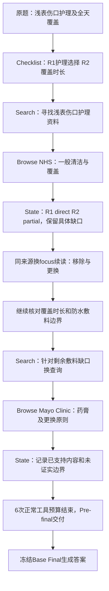

# Q45：围绕敷料使用缺口，完成可追溯的证据交付

[案例索引](../README.md) · [四组完整问题记录](../../../versions/process_final_sft/experiments/newbench_20261028/questions/Q45.md) · [结构化原始摘录](CASE.json) · [模型Final原文](final_answer.md)

这是新HealthBench子集Q45的GRPO25真实记录。原题询问浅表伤口能否使用非处方抗菌膏和敷料，以及全天覆盖是否合适。完整英文原题、原始ID及哈希保留在上方逐题页和`CASE.json`。

## 一分钟看完整路径

## Checklist与动作

模型拆成两项需求，程序分配R ID：R1核实药膏、敷料及其他护理需求；R2核实全天覆盖的一般安全性。完整模型原文保存在`CASE.json`，包括原始措辞。

| 轮次 | 实际执行 | 目标与回执 |
|---|---|---|
| 1 | web Search，绑定R1 | 发现来源；此时没有E证据 |
| 2 | Browse NHS，绑定R1 | 获得E1–E3，读取一般清洁、覆盖和就医原则 |
| 3 | 同一NHS来源，绑定R2，改变reading_focus | 获得E4–E6，核对移除及重换；不是重复Search |
| 4 | 同一来源继续围绕R2读取 | 获得E7–E8，继续检查时长与防水敷料边界 |
| 5 | 新web查询，绑定R2 | 围绕尚未明确的全天覆盖问题找补充来源 |
| 6 | Browse Mayo Clinic，绑定R2 | 获得E9–E11，补充药膏与每日/湿污时更换原则 |

共有2次Search、4次Browse，未出现完全相同Search额外动作。11个E ID是登记的片段，不表示11篇来源或11条独立医学事实；片段来自两个网页，具体窗口和作用域各自保留。

## 实际读到并交付了什么

下列是原始片段中的短摘录，完整原文未公开；两条均可在本记录真实Final输入中定位。

- **NHS，E2**：[Cuts and grazes](https://www.nhs.uk/conditions/cuts-and-grazes/)：`cleaning the wound, and covering it with a plaster or dressing.`
- **Mayo Clinic，E9**：[Minor cuts and scrapes](https://www.mayoclinic.org/first-aid/first-aid-cuts/basics/art-20056711)：`Put on an antibiotic or petroleum jelly.`；`Do this at least once a day or whenever the covering becomes wet or dirty.`

`CASE.json`同时给出source_id、chunk_id、完整片段哈希、摘录字符范围和已交付标记，可以区分Search预览、Browse原文与实际Final输入。

## State怎样变化，为何结束

第一次Browse后，R1被标记为direct，R2为partial。模型仍在gap中保留“当前证据没有明确推荐抗菌膏”“全天覆盖的时长和伤害边界尚未回答”等限制，随后围绕R2继续读取。

末次State将R1、R2均标为direct，引用E2与E9，同时保留“并非所有防水敷料全天覆盖都已证明无害”的边界。四次State调用的before、delta和after均保留，读者可检查标签与gap是否一致，而不是只看一个最终direct标签。

**实际停止方式是`runtime_budget_exhausted`：6次正常动作预算用完。** 没有模型Stop输出，不补造“模型认为充分后停止”。程序随后构建Pre-final；实际Final输入含E1–E11，再由冻结Base Final回答。

## Final与已有评分

完整模型答案见[Final原文](final_answer.md)。保留其原有措辞及引用，不把案例改写成更完善的医疗答案；JSON保留源答卷字符串，Markdown仅统一行尾。

| 组别 | 实际交付覆盖 | Process P/100 | Process R | HealthBench原分 |
|---|---:|---:|---:|---:|
| Base | 50.00% | 65.00 | 0.6500 | 0.0000 |
| Process-SFT | 100.00% | 85.00 | 0.8500 | 0.1923 |
| GRPO13 | 100.00% | 82.50 | 0.8250 | 0.2885 |
| GRPO25 | 100.00% | 100.00 | 1.0000 | 0.2885 |

本地Process评价认为本条实际交付满足共同内容点，未确认重大过程错误；这与Final答案是否满足全部HealthBench判据是两件事。Final原分为0.2885，因此本例展示的是**证据交付完成和模块分工**，不宣称医学回答满分，也不以一个案例证明总体优势。
