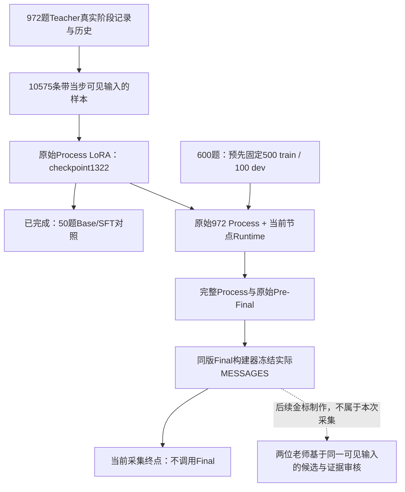

# 版本三：Process-SFT + Final-SFT

[返回首页](../../README.md) · **[全部100条Process评测](process_review_v2/README.md)** · [HealthBench答案评分](latest50_evaluation.md#3-healthbench-style答案评分) · [评测与四组消融计划](evaluation.md) · [GRPO算法计划](grpo.md)

## 已完成评测：原始972 Process-SFT · Latest50

本次比较 **Base全流程** 与 **原始972 Process-SFT + 同一个Base Final**，共50题、100条轨迹。SFT使用原始972训练的checkpoint1322。本节仅报告本次运行，身份与参数以冻结归档为准。

| 评测层次 | 指标与分母 | Base | Process-SFT + Base Final |
|---|---|---:|---:|
| Process | 有效证据覆盖均分，各50题，含失败 | 43.75% | **53.83%** |
| Process | 有效信息覆盖胜出题数，另14题相当 | 11 | **25** |
| 行为背景 | 被接受State调用数，非质量分 | 83 | 169 |
| 工程 | Process硬失败，各50条 | 6 | **2** |
| HealthBench-style答案 | 共同有评分40题的均分 | **7.23%** | 5.96% |
| 答案评分覆盖 | 全部50题 | 43/50 | 46/50 |

Process不因链路更长直接扣分，而是看新增证据是否真正覆盖问题。SFT更常带来有效信息、硬失败更少，但本次答案均分未同步提升。State更新次数和信息负荷不同，不能以累计重复/错误数判断优劣；最终State量表仅作诊断，逐断言及更新机会归一的比较尚未完成。不合并成一个总分，也不据此断言泛化优劣。Process为非盲离线暂定审核；答案采用Qwen3.7-max替代裁判，非医学准确率或官方HealthBench榜单。

**完整Process评测：[全部100条Process评测](process_review_v2/README.md)**，包含评分规则、全50题配对表、全部100条逐项评分和具体问题记录。**答案评测：[HealthBench 50题明细](latest50_evaluation.md#3-healthbench-style答案评分)**，与Process分开报告。

## 当前设计与完成状态

本版本将证据获取与答案综合解耦：Process负责Checklist、动态Search/Browse、State与Stop；Final只根据实际可见Pre-Final综合答案。当前已用于对照与采集的是原始972 Process LoRA checkpoint1322；Final对照仍使用无项目adapter的同基座。后续独立Final LoRA尚不能作为本次已训练能力报告。

| 内容 | 当前状态与边界 |
|---|---|
| Process训练 | 972题、10,575条合法阶段目标、1轮、1,322次更新；原始checkpoint1322 |
| 同题对照 | 50题×Base/SFT，共100条；Process与答案分别评，失败不隐藏 |
| 新Pre-Final采集 | 采集范围600题，提前分500 train / 100 dev；三题试采正常完成并冻结输入 |
| 数据质量 | 工程完整不等于合格金标；乱码、State误读、缺证据与失败保留待审 |
| Final | 本批只冻结输入，不生成Final/Judge，不启动训练；不宣称全600已完成 |

本页当前设计与下方保留的后续计划分开。公开训练脚本与组件含既有快照，不能凭旧目录名推断为checkpoint1322或当前600题包的逐字源码；版本边界见[代码导航](../../docs/code_navigation.md)。

## 迭代原因

统一学习工具决策与长答案，难以区分错误来自证据获取还是答案综合。当前将Process信息收益、State质量、工程失败和固定Base Final的答案分分别报告，不把链路更长直接扣成低质量，也不把更多E片段直接当作收益。

## 数据与训练路线



原始Teacher数据保留真实messages、合法输出、工具回执和因果历史；并非将一整条长轨迹作为一个completion，也不是把历史丢掉只学孤立动作。训练输入以原采集记录为准；参考源码不能冒充Teacher当时完整冻结源码。见[采集与导出方法](../../docs/codex_cli_collection.md)。

600题按来源/主题分层，同源及词面近似组不跨500/100划分。来源、类别、DOI和split仅供审计，Agent只接收question原文。近似排重是已知题池范围的筛查，不声称全球语义不重复。100题dev用于开发与选择，不宣称是从未接触的正式测试；最终可用训练数以质量审核为准，不因预定500就强行填满。

采集使用同一WORK断点续队列，已完成attempt（包括已记录失败）不自动重抽；未知pending/lease须人工对账。导出包含失败、SQLite一致性备份和逐文件哈希，不包含权重或凭据。三题输入完整性通过不等于医学审核通过，不悄悄修写其State。

## Process-SFT

### 轨迹拆分

一条轨迹按当前阶段拆分为：原题 + Compact History + 当前Checklist/State + 候选或已读证据 → 当前阶段completion。

- Checklist：监督独立需求与共享范围。
- Decision：监督具体Search query、Browse来源ID及阅读重点，不只监督动作类别。
- State：监督有证据来源的状态更新与未解决缺口。
- Stop：属于Decision的合法停止动作；正常工具预算耗尽时由程序结束，不伪造模型Stop目标。
- Final：不作为Process target，不进入更早阶段历史。

输入、历史和工具Observation全部mask，仅当前合法completion计算CE。拒绝尝试保留反馈与因果记录，不自动作为合格正监督。原始训练使用当时真实可见输入；当前推理与导出共用阶段构建器，但不能宣称已与旧Teacher完整源码、预算和候选处理逐字一致。

### 参数

| 项目 | 配置 |
|---|---|
| Base / adapter | Qwen3-8B + fresh Process LoRA |
| 题目与阶段数 | 972题；Checklist972、Decision6143、State3460，共10575条 |
| Epoch / batch | 1轮；microbatch1；accum8 |
| LoRA | r32、alpha64、dropout0.05 |
| LR / optimizer | 1e-4；AdamW；warmup67更新后cosine；weight decay0.01，grad clip1.0 |
| 精度 / attention | NF4 double quant、BF16 compute、FP32 LoRA；deterministic Flash |
| 原训练预算 | 10,240；最长编码样本9,762 tokens，不用当前推理预算追改训练身份 |
| Loss | effective batch内target-token mean；Checklist/Decision/State权重均1 |
| 更新步数 | ceil(10575/8)=1322；最后一批7条 |
| 验证集合 | 原训练包972题全部用于训练，没有包内dev；不声称已有独立验证损失 |
| Final / Pre-Final目标 | Final目标0；Pre-Final是程序输出，不计算loss |

原始972训练按冻结训练包的数据、模型和源码哈希核验。当前目录的[公开Process脚本](process/train.py)保留其原配置身份，仅作代码参考，不能直接当作972训练器运行凭证或更改其规模gate来复现。当前推理改动与训练样本保持独立身份。

### Loss公式

设effective batch为 $B$，样本 $i$ 的合法当前target位置为 $T_i$，token交叉熵为 $\ell_{it}$。原始972各阶段权重均为1：

```math
\ell_{it}=-\log\pi_{\theta_P}(y_{it}\mid x_i,y_{i,\lt t}).
```

批次损失为：

```math
\mathcal L_P(B)=\frac{\sum_{i\in B}\sum_{t\in T_i}\ell_{it}}{\sum_{i\in B}|T_i|}.
```

每个microbatch先计算当前target的CE总和，再除以该effective batch全部有效target-token数并累积梯度；最后不足8条按实际token数归一。不是各样本先取均值后等权，也不是按整个epoch的token量固定缩放。输入、工具、错误尝试和程序Pre-Final全部mask。模型可从历史中学习Search→Browse→State→再决策，但正确语法与历史可见不保证学到稳定策略。

### Process开发评测方法

在同题、matched seed、相同检索与工具预算下比较Base与Process-SFT，检查实际证据覆盖、State事实与绑定、缺口更新和停止行为。更新次数与链路长度单列，不作为质量扣分；不以Final写作差异代替Process质量。已完成结果统一见上方本次50题评测。

## Pre-Final与Final-SFT

### 输入与金标

当前600题用同版ContextBuilder准备实际Final请求，不调用Final。完整 `run/PRE_FINAL_PACKAGE.json` 用于审计；`teacher_input/FINAL_REQUEST.json`、`MESSAGES.json` 和同内容的 `TEACHER_INPUT.txt` 是冻结老师输入。三题服务端核验了原始证据一致性、messages哈希、精确token与预算；总占用分别9256、7633、7400，均低于15000。它们仍有乱码或State语义等待审问题，不能据此认定金标合格。

两位老师只读取同一冻结MESSAGES，不能额外联网补出输入没有的事实。候选按证据支持、范围、完整性与引用审核，而非只选文笔；两份都不合格就留置。Final可纠正State误判，但不能编造缺失证据；后续训练必须绑定同一MESSAGES与split，不能换packing沿用旧答案。引用用E ID并映射到原始chunk，输出单个answer envelope。

### 当前批次边界

600题的500/100是Final用途的预划分，不是500份金标已生成或Final已训练。当前只采Process并冻结输入；学习率、轮次、checkpoint选择等后续训练决定本次不新增或调整。目录中的[Final配置](final/TRAIN_CONFIG.json)和训练脚本是既有参考快照，不作为这600题的已执行配置。

### Loss公式

对固定Pre-Final输入 $x_i$ 及审核gold answer $y_i$，只监督Final target集合 $T_i$：

```math
\mathcal L_F(B)=
\frac{\sum_{i\in B}\sum_{t\in T_i}-\log\pi_{\theta_F}(y_{it}\mid x_i,y_{i,\lt t})}
{\sum_{i\in B}|T_i|}.
```

这是effective batch内有效target-token均值，不是各样本先均值再等权。该Final-only公式说明监督边界，不表示当前600题已经启动训练。引用token属于答案target；引用合法性与语义支持另行审核。[已有参考脚本](final/train_final.py)保留原配置身份。

## 后续计划（原文保留，待讨论）

以下保留既有开发/评测/GRPO计划，本次不改样本数、组合和算法；其中数量不代表当前600题采集或972训练的执行记录，也不构成对新方案的确认。[独立评测计划](evaluation.md)与[GRPO计划](grpo.md)保持不变。

### 38题六checkpoint开发计划

冻结同一38题Pre-Final，每题生成Base及六个Final-SFT checkpoint答案：38×7=266个答案。共用Prompt、citation合同、matched seed和采样配置。该实验不重新检索，比较综合、覆盖、概念/数字绑定与引用支持，据此选择Frozen Final；不提前填入效果结果。

## 正式评测与GRPO

Process38与Final38是开发定位；之后冻结独立HealthBench20题，执行[1/2/3/4四组双轨评测](evaluation.md)。最后按[GRPO公式与算法](grpo.md)只更新Process、固定Final。开发题若用于选择Prompt或checkpoint，不再声称是独立最终测试。
