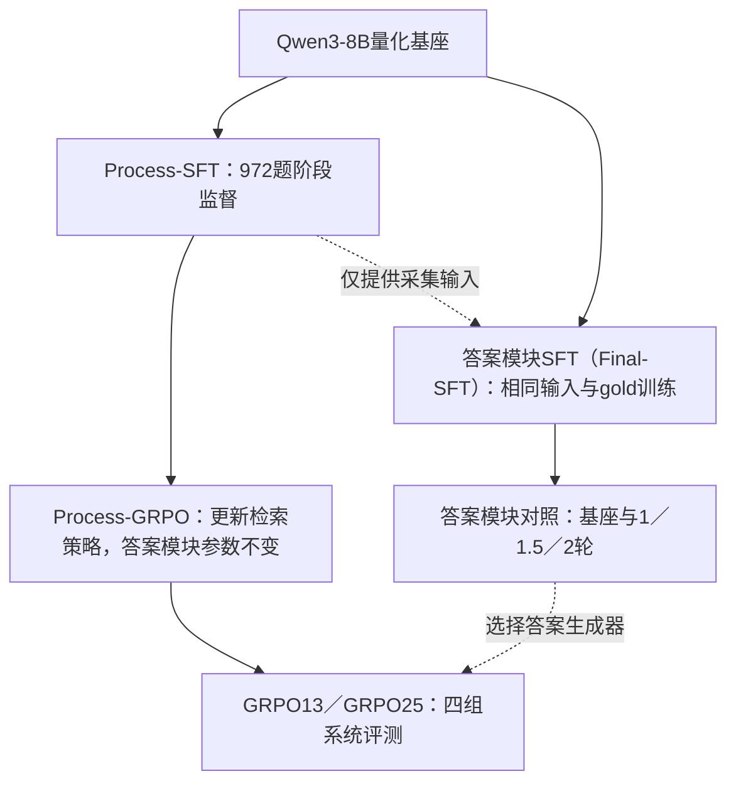

# 版本三｜Process-SFT到Process-GRPO的实验地图

检索与证据整理策略（Process）围绕问题缺口获取、判断并交付材料；答案生成模块（Final）根据原问题和实际可见材料综合回答。当前训练主线为Process-SFT→Process-GRPO，另有答案模块监督微调（Final-SFT）的单独对照实验；本页定位训练、对照与评测资料。

[项目首页](../../README.md) · [真实案例](../../examples/version3_cases/README.md) · [名词与指标解释](glossary.md) · [当前源码](current/README.md)

## 参数主线与独立对照

| 工作 | 输入／初始化 | 更新对象 | 已完成产物 |
|---|---|---|---|
| [Process-SFT](process_sft.md) | 基座＋Teacher阶段样本 | Process LoRA | 972题、10,575阶段样本、1,322次更新 |
| [Process-GRPO](grpo.md) | 原972 Process adapter＋封存轨迹与奖励 | 继续更新Process LoRA | 100题×4条；99组可用、25批；保留GRPO13／25 |
| [答案模块SFT对照（Final-SFT）](final_sft.md) | 基座＋固定答案输入快照与指定gold | 单独训练答案模块LoRA | 500训练题；dev100比较基座及1／1.5／2轮 |
| 系统评测 | 四种Process策略，使用同一基座答案生成器 | 不更新参数 | 开发对照与跨基准验证均有逐题记录 |

这里的“单独对照”指分别训练和评价答案模块，可以与Process共用同一Qwen3-8B基座。当前使用未启用项目微调参数的基座答案生成器（Base Final）；Process-GRPO只更新检索策略。**答案模块参数保持不变，不代表各组答案相同：它们接收的检索材料可以不同。** 两种模块的选型依据分别报告。

## 三项评测与当前选择

- **[跨基准验证评测 · HealthBench50＋MedBrowseComp50](experiments/newbench_20261028/README.md)**：四组同配置重新检索，共400条。HB核心答案正确率Base／SFT／GRPO13／GRPO25为52%／54%／60%／52%；HB必要信息齐全率为30%／44%／46%／50%。当前以GRPO25作为Process证据交付主候选，GRPO13保留为HB答案指标对照；[准确率标准与MB任务边界](experiments/newbench_20261028/accuracy.md)及每题四组理由均可核对。
- **[Process开发对照评测 · HealthBench50](experiments/process_grpo_20261026/README.md)**：50题、四组200条，用于开发诊断和checkpoint比较。Base/SFT与GRPO的运行差异单列，不作为严格同runtime因果实验。
- **[Final模块对照评测 · dev100](experiments/final_sft_dev100/README.md)**：每题给四种答案配置同一份实际输入，比较基座答案生成器与三个答案模块SFT checkpoint。三个checkpoint在本次对照中未超过基座，因此当前使用基座模型生成答案。

[评测地图与指标定义](evaluation.md)解释各自固定什么、比较什么、怎样计分；[逐题索引](records.md)保留三项评测的全部原题、评分和具体问题。

## 按问题阅读

| 想回答的问题 | 页面 |
|---|---|
| Agent实际做过什么？ | [Q45证据交付＋Q98失败定位](../../examples/version3_cases/README.md) |
| 单题怎样运行，模型与程序如何分工？ | [系统架构与执行机制](engineering.md) |
| 使用什么模型、题集、配置和数据隔离？ | [数据与实验设置](design.md) |
| SFT怎样构造目标、mask与计算loss？ | [Process-SFT](process_sft.md) |
| GRPO怎样把评分转成参数更新？ | [奖励、概率校正与训练算法](grpo.md) |
| 为什么用基座模型生成答案？ | [答案模块的监督微调对照](final_sft.md) |
| 指标和失败分母怎样解释？ | [评测方法](evaluation.md) · [术语](glossary.md) |
| 源码、测试及冻结实验在哪里？ | [当前源码入口](current/README.md) · [代码导航](../../docs/code_navigation.md) |

## 记录与公开范围

实际评测原题、分项评分和审核摘要可在逐题页核对。完整批量答卷、gold、逐字证据、权重与回执留在私有归档；少量真实案例按案例页范围公开原始输出与短证据摘录。

源码审阅、合成工程测试与医学质量评价分别记录。下一轮采集、训练和新增研究设计见[后续设计](grpo.md#后续设计先固定结论边界再决定新一轮)，不将计划写成已完成结果。此前计划保留于[历史归档](archive/README.md)。
