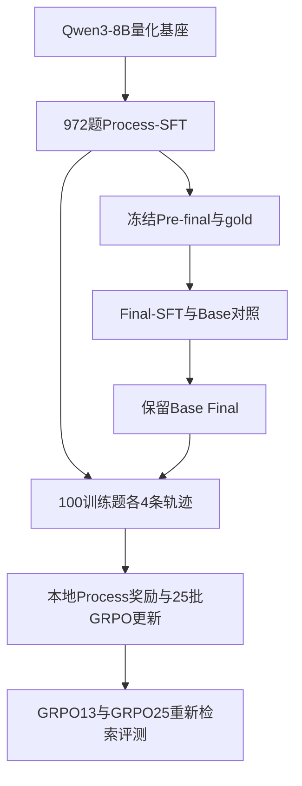

# 版本三｜Process与Final解耦训练

**让小模型先找对证据，再可靠地使用证据回答。** 本版本把真实检索过程与答案综合分开训练、分开评价；当前已完成Process-SFT、Final-SFT对照，以及冻结Base Final下的一轮Process-GRPO。

[项目首页](../../README.md) · [源码入口](current/README.md) · [历史归档](archive/README.md)

## 阅读顺序

| 章节 | 主要内容 |
|---|---|
| **[1. 系统设计与题集](design.md)** | 模型、节点、检索、Pre-final、题目来源与数据隔离 |
| **[2. Process-SFT](process_sft.md)** | 972题如何变成阶段样本，mask、loss与真实训练参数 |
| **[3. Final-SFT实验](final_sft.md)** | gold构建、500/100划分、Base对照与暂不加训的依据 |
| **[4. Process-GRPO](grpo.md)** | 400条轨迹、本地奖励、概率校正、25批更新及后续设计 |
| **[5. 评测方法与结果](evaluation.md)** | 指标含义、完整对照表、失败、统计边界与模型选择 |
| **[6. 逐题评分与问题](records.md)** | 新增100题Process四组、旧50题及Final对照；每条有评分与问题 |

## 已完成的实验

| 实验 | 规模 | 当前结果 |
|---|---|---|
| Process-SFT | 972题、10575阶段样本、1322次更新 | 作为后续Process策略起点 |
| Final-SFT | 500训练题；dev100×Base及三个checkpoint | SFT的1/1.5/2轮均未超过Base Final |
| Process-GRPO | 100题×4条，99组可用、25批更新 | 保留第13批中途与第25批最终checkpoint |
| 新题同配置验证 | HealthBench50 + MedBrowseComp50，四组共400条 | 100题逐条评分/问题、失败与胜负全部可查 |
| Process开发评测 | 50题×Base/SFT/GRPO13/GRPO25 | 200条逐题审核；188个有效HealthBench-style答案分 |

**新增100题同配置检验已完成，GRPO改进有逐题证据。** 四组各100条全部保留：GRPO13/25均无完全重复Search；重大或Process失败题数均14，少于SFT的17和Base的21。GRPO25在两个benchmark的证据交付覆盖最高，作为当前Process主候选；GRPO13保留为HealthBench答案指标对照。逐题胜负和失败并非全面占优，完整结果见[新100题评测](experiments/newbench_20261028/README.md)。

**当前答案模块仍选Base Final。** 在相同冻结输入的共同有效97题上，Base为77.06分，Final-SFT的1/1.5/2轮分别为58.40、61.57、65.98分；这些是项目评分，不是HealthBench分。[查看为何暂停加训](final_sft.md#为什么没有继续增加轮次)

## 研究路线

Base → Process-SFT → 独立Final对照 → 固定Base Final → Process-GRPO → 分开评测。

展开训练演进图

上图是训练演进；实际单题问答的节点与数据流见[系统设计](design.md#单题如何运行)。Final-SFT没有接入本轮GRPO，后者始终冻结Base Final。

## 如何理解这份记录

- **设计**：单Process策略、显式节点与真实工具，Final独立综合证据。
- **训练**：Process-SFT、Final-SFT、Process-GRPO分别记录初始化、数据、目标与checkpoint。
- **评测**：Process的信息交付与State可靠性单独打分，答案另用原生HealthBench rubric；不将两者都称为准确率。
- **后续**：新增题集同配置检验已完成；下一轮采集和训练仍须另行冻结，未在此启动。

公开内容包括方法、参数、脱敏评分及逐题问题摘要；新增100题、旧50题Process和dev100 Final均公开实际评测原题，每个逐题页均可对照阅读，见[逐题索引](records.md)。gold、模型答案、证据原句、权重与回执仍保存在私有归档。源码快照的适用身份与复现入口见[代码说明](design.md#实际交付与完整存档)。
