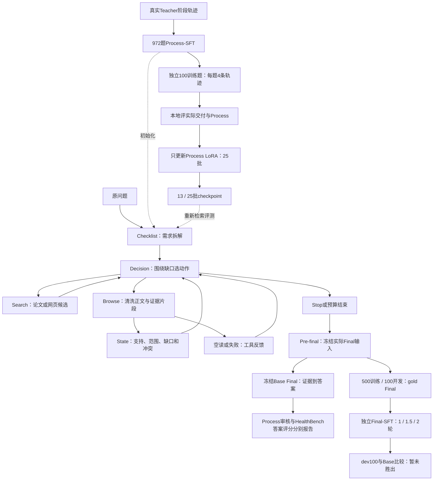

# 版本三：独立Process / Final训练与固定Final下的GRPO

[首页](../../README.md) · **[最新四组评测与50题记录](experiments/process_grpo_20261026/README.md)** · [Final-SFT与Base对照](experiments/final_sft_dev100/README.md) · [当前代码快照](current/README.md)

## 当前设计与完成状态

Process负责Checklist、动态Search/Browse、State与Stop，Final根据实际Pre-final综合答案。当前已完成Process-SFT、独立Final-SFT探索及固定Base Final下的一轮Process-GRPO；训练和评测分开登记，不把工程验收当医学质量通过。

| 阶段 | 已完成记录 | 当前结论 |
|---|---|---|
| Process-SFT | 972题、10575阶段目标、1轮1322次更新 | 后续Process-GRPO的初始化策略 |
| Pre-final与gold | 600题采集及后续金标整理；固定500 train / 100 dev | 原始失败、审核及输入身份另存，不因完成采集宣称全无问题 |
| Final-SFT | 独立Final LoRA，1/1.5/2轮checkpoint；dev100四组400条评审 | 三个SFT均未超过Base Final，未继续盲目加训 |
| Process-GRPO | 100题×4条；99组可用、1组留置；25批一次遍历 | 保留13批和25批；Final始终冻结Base |
| 四组开发对照 | 历史Base/SFT各50条＋新GRPO13/25各50条 | 200条Process、188个HB分，失败全部保留 |

当前主要发现：GRPO13交付覆盖69.75%，历史SFT55.83%、Base48.42%；同题HB点估计也较高，但重大State问题仍在、综合R改善不明确。GRPO13作为后续验证候选，GRPO25完成率更高。历史配置差异与区间跨0限制因果/显著性结论，详见[完整结果](experiments/process_grpo_20261026/README.md)。

## 完整流程与实验演进



Final-SFT与GRPO是先后开展的独立探索；GRPO没有加载Final-SFT adapter，也没有把HealthBench测试题或评分用于本轮更新。训练来源、目标、概率校正与更新参数见[实际训练算法](experiments/process_grpo_20261026/training.md)。

## 当前评测入口

- **[四组结果、失败与50题逐题记录](experiments/process_grpo_20261026/README.md)**：最新统一口径的200条Process与HealthBench结果。
- **[Final-SFT与Base：dev100、400条评分](experiments/final_sft_dev100/README.md)**：训练参数、对照结果、mask审计和暂不加训的理由。
- [Process评分规则](experiments/process_grpo_20261026/protocol.md)：覆盖40、State30、Checklist20、决策10，重大处理及失败边界。
- [GRPO实际算法与后续设计](grpo.md)：明确已执行的一次更新和待验证的下一阶段。
- [历史50题选题方法与原答案评分](latest50_evaluation.md)：保留选题、原rubric及历史评分身份；旧发现覆盖与新交付覆盖不混用。

## 为什么先SFT、再研究GRPO

Process-SFT提供需求拆解、具体工具决策及证据状态更新的监督起点。最新同规则历史审核中，SFT交付覆盖55.83%，Base48.42%，模型Process失败2/50对6/50；这些支持以SFT继续采集，但不证明所有指标更好。SFT综合R并未超过Base，State与Final利用仍需分别诊断。

独立Final-SFT在固定输入下未胜过Base，因此本轮选择保持Base Final，将后续训练对象收窄到Process。GRPO的奖励直接评实际交付内容及过程重大错误，避免将冻结Final自身的表达失误直接归因给Process。

## 题集与数据隔离

旧50题来自HealthBench原始题池，单轮英文医学检索问题，论文需求25题、网页/指南需求25题；保留原生rubric，评分点不输入模型。定向筛选并经过工程试跑，属于开发对照，不是独立未见最终测试。

Final600按来源/主题分层预划500/100；GRPO100来自train500的50道短题和LiveQA历史Train-1的50道长题，不使用Final dev100或HealthBench训练。GRPO100与旧50题ID/规范化文本交集为0；不据此承诺全球语义去重或无基座预训练污染。新题独立验证尚未启动。

公开仓库仅保留方法、配置说明、脱敏分数和逐题问题摘要。完整原问题、gold、模型答案、证据原句、权重及回执保留私有归档；current源码不随本次文档更新静默换版。版本一、二和其冻结源码不改。

## Process-SFT

### 轨迹拆分

一条轨迹按当前阶段拆分为：原题 + Compact History + 当前Checklist/State + 候选或已读证据 → 当前阶段completion。

- Checklist：监督独立需求与共享范围。
- Decision：监督具体Search query、Browse来源ID及阅读重点，不只监督动作类别。
- State：监督有证据来源的状态更新与未解决缺口。
- Stop：属于Decision的合法停止动作；正常工具预算耗尽时由程序结束，不伪造模型Stop目标。
- Final：不作为Process target，不进入更早阶段历史。

输入、历史和工具Observation全部mask，仅当前合法completion计算CE。拒绝尝试保留反馈与因果记录，不自动作为合格正监督。原始训练使用当时真实可见输入；当前推理与导出共用阶段构建器，但不能宣称已与旧Teacher完整源码、预算和候选处理逐字一致。

### 原始972已完成训练参数

本表描述生成checkpoint1322的那次Process训练，不是当前在线上下文配置，也不是后续Final训练参数。训练时从新初始化LoRA开始；当前运行加载已经训练完成的adapter，不重新初始化。

| 项目 | 配置 |
|---|---|
| Base / adapter初始化 | `Qwen/Qwen3-8B`；训练开始时新初始化Process LoRA，`initial_adapter=null` |
| 题目与阶段数 | 972题；Checklist972、Decision6143、State3460，共10575条 |
| Epoch / batch | 1轮；microbatch1；accum8 |
| LoRA | r32、alpha64、dropout0.05 |
| LoRA注入层 | q_proj、k_proj、v_proj、o_proj、gate_proj、up_proj、down_proj |
| LR / optimizer | 1e-4；AdamW；warmup67更新后cosine；weight decay0.01，grad clip1.0 |
| 优化器细项 / 随机种子 | AdamW betas=(0.9, 0.999)、eps=1e-8；seed=42 |
| 量化 / 计算精度 | bitsandbytes 4-bit NF4，double quant=True，BF16 compute；基座冻结，FP32 LoRA更新 |
| 训练attention / 显存策略 | Transformers SDPA，强制PyTorch Flash SDP后端并启用确定性算法；梯度检查点，训练use_cache=False；不是另行配置FlashAttention-2 |
| 原训练预算 | 10,240；最长编码样本9,762 tokens，不用当前推理预算追改训练身份 |
| Loss | effective batch内target-token mean；Checklist/Decision/State权重均1 |
| 更新步数 | ceil(10575/8)=1322；最后一批7条 |
| 验证集合 | 原训练包972题全部用于训练，没有包内dev；不声称已有独立验证损失 |
| Final / Pre-Final目标 | Final目标0；Pre-Final是程序输出，不计算loss |

原始972训练按冻结训练包的数据、模型和源码哈希核验。[实际原始972训练器](current/original972_training/train.py)、[token loss](current/original972_training/training_core.py)及[配置](current/original972_training/TRAIN_CONFIG.json)已公开；不附原题、编码数据或权重。本目录[既有Process脚本](process/train.py)保持原身份，不再作为972训练入口。当前推理改动与训练样本保持独立身份。

### 运行配置的身份

原始972训练参数维持上述历史身份。600题Pre-final使用当时公开current服务；新GRPO13/25评测使用独立原生采样入口与FP32 Process输出头，不能把current/serve_policy.py冒充新GRPO入口。两者提示词、检索、预算设计相同，具体差异见[运行配置对照](experiments/process_grpo_20261026/runtime.md)。

### Loss公式

设effective batch为 $B$，样本 $i$ 的合法当前target位置为 $T_i$，token交叉熵为 $\ell_{it}$。原始972各阶段权重均为1：

```math
\ell_{it}=-\log\pi_{\theta_P}(y_{it}\mid x_i,y_{i,\lt t}).
```

批次损失为：

```math
\mathcal L_P(B)=\frac{\sum_{i\in B}\sum_{t\in T_i}\ell_{it}}{\sum_{i\in B}|T_i|}.
```

每个microbatch先计算当前target的CE总和，再除以该effective batch全部有效target-token数并累积梯度；最后不足8条按实际token数归一。不是各样本先取均值后等权，也不是按整个epoch的token量固定缩放。输入、工具、错误尝试和程序Pre-Final全部mask。模型可从历史中学习Search→Browse→State→再决策，但正确语法与历史可见不保证学到稳定策略。

### Process开发评测方法

在同题、matched seed、相同检索与工具预算下比较Base与Process-SFT，检查实际证据覆盖、State事实与绑定、缺口更新和停止行为。更新次数与链路长度单列，不作为质量扣分；不以Final写作差异代替Process质量。已完成结果统一见上方本次50题评测。

## Pre-final与Final-SFT的监督边界

完整PRE_FINAL_PACKAGE用于审计，真正训练和评分绑定实际Final请求MESSAGES。老师候选只能使用相同输入中的证据；Final可以纠正State误判，但不能编造缺失证据。独立Final LoRA从新初始化开始，gold答案和EOS计算CE，输入、工具及证据mask；引用token属于答案target，语义支持另审。

实际已完成参数、四组dev100结果与具体问题见[Final实验](experiments/final_sft_dev100/README.md)。不能把原目录final参考脚本直接称作最新服务器入口；完整执行包和绑定清单另存。原始972训练合同及本轮Final/GRPO合同各自保留，不能互相追溯改写。

<details>
<summary>早期后续计划原文存档（与本轮实际执行分开）</summary>

## 后续计划（原文保留，待讨论）

以下保留既有开发/评测/GRPO计划，本次不改样本数、组合和算法；其中数量不代表当前600题采集或972训练的执行记录，也不构成对新方案的确认。[独立评测计划](evaluation.md)与[GRPO计划](grpo.md)保持不变。

### 38题六checkpoint开发计划

冻结同一38题Pre-Final，每题生成Base及六个Final-SFT checkpoint答案：38×7=266个答案。共用Prompt、citation合同、matched seed和采样配置。该实验不重新检索，比较综合、覆盖、概念/数字绑定与引用支持，据此选择Frozen Final；不提前填入效果结果。

## 正式评测与GRPO

Process38与Final38是开发定位；之后冻结独立HealthBench20题，执行[1/2/3/4四组双轨评测](evaluation.md)。最后按[GRPO公式与算法](grpo.md)只更新Process、固定Final。开发题若用于选择Prompt或checkpoint，不再声称是独立最终测试。

</details>
