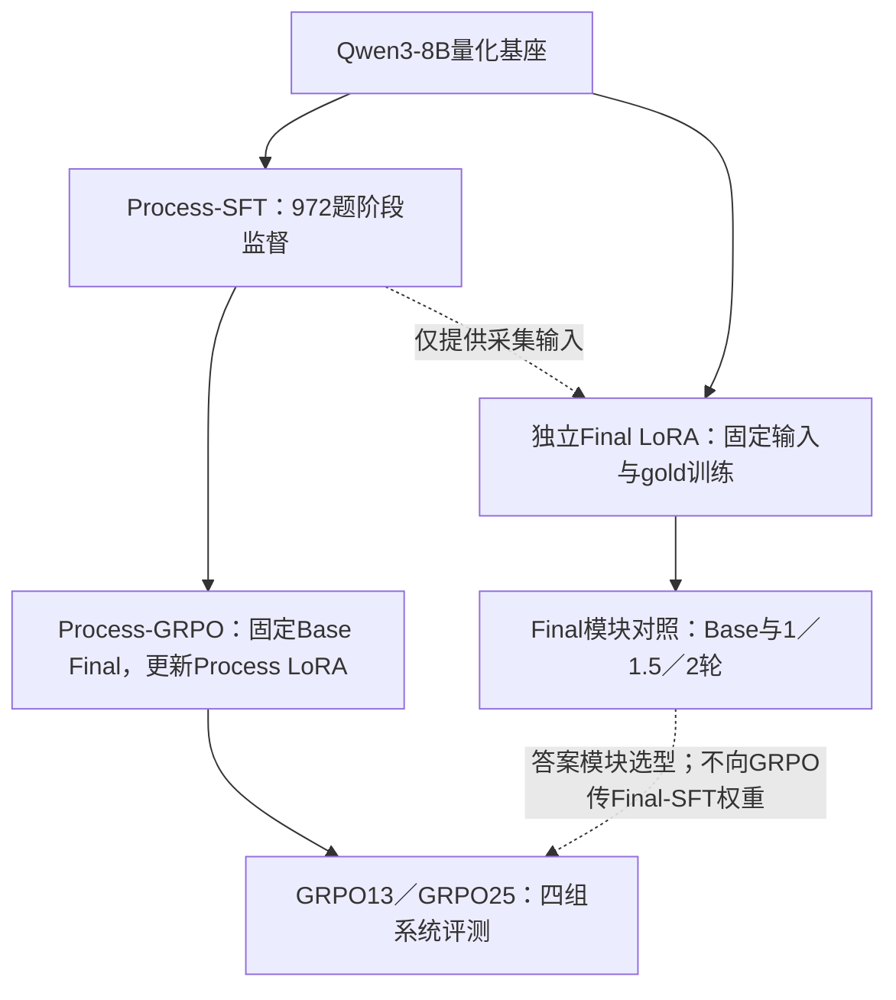

# 版本三｜Process-SFT到Process-GRPO的实验地图

Process围绕问题缺口获取、判断并交付证据，Final根据实际输入综合答案。当前以Process-SFT→Process-GRPO为参数更新主线，Final-SFT用于独立模块对照；系统运行机制见[完整架构](engineering.md)，本页定位训练、对照与评测资料。

[项目首页](../../README.md) · [真实案例](../../examples/version3_cases/README.md) · [名词与指标解释](glossary.md) · [当前源码](current/README.md)

## 参数主线与独立对照

| 工作 | 输入／初始化 | 更新对象 | 已完成产物 |
|---|---|---|---|
| [Process-SFT](process_sft.md) | 基座＋Teacher阶段样本 | Process LoRA | 972题、10,575阶段样本、1,322次更新 |
| [Process-GRPO](grpo.md) | 原972 Process adapter＋封存轨迹与奖励 | 继续更新Process LoRA | 100题×4条；99组可用、25批；保留GRPO13／25 |
| [Final-SFT独立对照](final_sft.md) | 基座＋固定Final输入与指定gold | 独立Final LoRA | 500训练题；dev100比较Base及1／1.5／2轮 |
| 系统评测 | 四种Process策略，Final固定Base | 不更新参数 | 开发对照与跨基准验证均有逐题记录 |

Final-SFT影响答案模块选型，未作为GRPO初始化或训练产物接入。当前固定Base Final的依据来自dev100对照；Process的交付候选依据来自系统评测，两种选型分别报告。

## 三项评测与当前选择

- **[跨基准验证评测 · HealthBench50＋MedBrowseComp50](experiments/newbench_20261028/README.md)**：四组同配置重新检索，共400条。当前以GRPO25作为Process证据交付主候选，GRPO13保留为HealthBench答案指标对照；完整报告列出逐题胜负、重大错误、轨迹失败及不确定性。
- **[Process开发对照评测 · HealthBench50](experiments/process_grpo_20261026/README.md)**：50题、四组200条，用于开发诊断和checkpoint比较。Base/SFT与GRPO的运行差异单列，不作为严格同runtime因果实验。
- **[Final模块对照评测 · dev100](experiments/final_sft_dev100/README.md)**：100题相同冻结输入，比较Base Final和三个Final-SFT checkpoint。三个checkpoint在本次对照中未超过Base，因此本轮GRPO保留Base Final。

[评测地图与指标定义](evaluation.md)解释各自固定什么、比较什么、怎样计分；[逐题索引](records.md)保留三项评测的全部原题、评分和具体问题。

## 按问题阅读

| 想回答的问题 | 页面 |
|---|---|
| Agent实际做过什么？ | [Q45证据交付＋Q98失败定位](../../examples/version3_cases/README.md) |
| 单题怎样运行，模型与程序如何分工？ | [系统架构与执行机制](engineering.md) |
| 使用什么模型、题集、配置和数据隔离？ | [数据与实验设置](design.md) |
| SFT怎样构造目标、mask与计算loss？ | [Process-SFT](process_sft.md) |
| GRPO怎样把评分转成参数更新？ | [奖励、概率校正与训练算法](grpo.md) |
| Final为什么保留Base？ | [Final-SFT独立对照](final_sft.md) |
| 指标和失败分母怎样解释？ | [评测方法](evaluation.md) · [术语](glossary.md) |
| 源码、测试及冻结实验在哪里？ | [当前源码入口](current/README.md) · [代码导航](../../docs/code_navigation.md) |

## 记录与公开范围

实际评测原题、分项评分和审核摘要可在逐题页核对。完整批量答卷、gold、逐字证据、权重与回执留在私有归档；少量真实案例按案例页范围公开原始输出与短证据摘录。

源码审阅、合成工程测试与医学质量评价分别记录。下一轮采集、训练和新增研究设计见[后续设计](grpo.md#后续设计先固定结论边界再决定新一轮)，不将计划写成已完成结果。此前计划保留于[历史归档](archive/README.md)。
