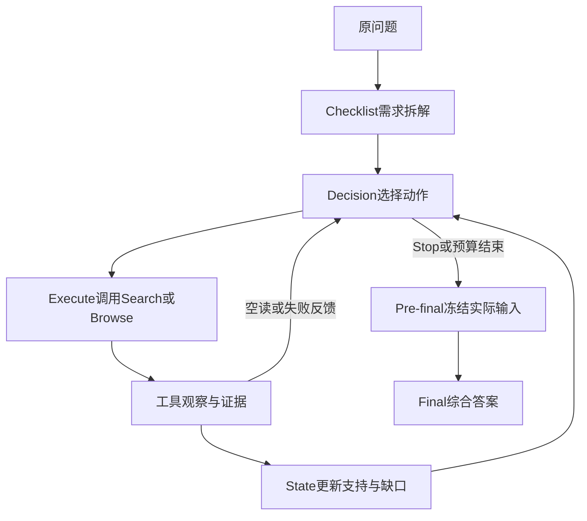

# 1. 系统设计与题集

[概览](README.md) · **系统与数据** · [逐步工程设计](engineering.md) · [Process-SFT](process_sft.md) · [Final-SFT](final_sft.md) · [GRPO](grpo.md) · [评测](evaluation.md) · [逐题记录](records.md)

[名词与指标解释](glossary.md)

## 研究目标与模型角色

目标是让8B模型围绕问题缺口自主选择搜索、打开来源并整理可追溯证据，再交给答案模块。工程合同保证数据和动作可核验；医学支持程度仍由模型判断，并在评测中检查。

基座为`Qwen/Qwen3-8B`，通过bitsandbytes以4-bit NF4双重量化加载，BF16计算。Base指同一基座禁用本项目adapter，不是另一份名为Qwen3-8B-Base的模型或未量化对照。

| 角色 | 输入与职责 | 参数状态 |
|---|---|---|
| Base Process | 原题与当步上下文，生成需求、决策、State | 禁用项目adapter |
| Process-SFT / GRPO | 同一Process协议，策略不同 | 分别加载原972或GRPO adapter |
| Base Final | 原题、实际交付的证据和State，综合答案 | 禁用Process adapter，保持冻结 |
| Final-SFT | 相同Final输入合同，学习gold答案 | 独立新建Final LoRA；本轮GRPO不采用 |
| 压缩兜底 | 预算压力下处理已给定材料 | 同基座禁用Process adapter，不自主检索 |

LoRA不是多套独立基座。Process与Final按角色切换；Process-GRPO采集及跨基准四组验证使用冻结FP32 Process线性输出头，Final恢复原输出头。开发对照中Base/SFT与GRPO的数值路径差异另见[运行配置对照](experiments/process_grpo_20261026/runtime.md)。

## 单题如何运行

| 阶段 | 模型决定什么 | 程序核验什么 |
|---|---|---|
| Checklist | 原题有哪些可核验需求和共享范围 | 字段、需求ID与结构 |
| Decision | Search/Browse/Stop、需求绑定、query或reading_focus | 合法动作、来源可见性、预算与绑定 |
| Execute | 工具执行模型选定动作，不生成医学结论 | 调用真实工具、记录成功/失败与原文坐标 |
| State | 哪些证据支持需求、还有哪些缺口/冲突 | E ID存在、引用来自已打开证据、字段合法 |
| Pre-final | 无独立模型决策 | 汇集状态，构建并冻结真正要交给Final的请求 |
| Final | 根据可见材料回答，注明限制和引用 | 输出格式与引用ID；语义是否支持另行审核 |

LangGraph负责节点编排，ReAct描述决策—工具—观察—再决策的循环，MCP封装真实工具。它们服务于一个Process策略，不表示多个自主Agent轮流检索。持久化用自有SQLite Store与调用回执，支持可审计的断点续跑。

[逐步工程设计](engineering.md)展开每一步的输入、处理方式、设计理由与适用限制：从需求拆解、重复查询缓存、单次reading_focus，到正文保护、State、Pre-final及worker来源恢复。

## Search与Browse的区别

Search返回标题、摘要或snippet及候选元信息，不能直接记为已读正文。Browse按来源和阅读重点取得实际文本，完成清洗、片段选择与E ID绑定；Final只能使用实际交付材料，不能借搜索预览补证据。

论文来源包括PubMed、Semantic Scholar，网页发现使用Serper；本地排序与片段处理不由Google Drive承担。Google Drive只用于文件传输。

| 组件 | 实际作用 |
|---|---|
| 检索排序 | 原问题相关性0.6＋当前query相关性0.4；使用本地Cross-Encoder |
| embedding | bge-small-en-v1.5 |
| reranker | MedCPT-Cross-Encoder |
| 查询缓存 | 同题、同channel、同规范化query复用结果；不重复发外部搜索 |
| 候选可用性 | 未读优先；明确当前路由不可读/耗尽的候选移出当前可选集，记录仍保留 |
| Browse失败 | 留下原因与反馈，允许模型换来源/改query；失败不证明不存在证据 |
| 证据交接 | 已读原文、来源、ID及状态按预算投影，保留无损引用的解析规则 |

### 检索文本与证据正文使用不同预算

原题检索锚点最多640个UTF-8字节；本次query/reading_focus在检索投影中最多320个UTF-8字节。每次调用独立处理，不累计。它们用于保持检索意图简洁，不限制返回证据正文的长度；完整原题仍由模型节点上下文携带。动作结构中的Text字段另有1200字符上限，两层含义见[Browse与reading_focus](engineering.md#5-browse与reading_focus围绕本次缺口读取来源)。

### 有界清洗与来源连续性

清洗保留模板/指南短列表规则，并优先保护事实、否定比较、数值单位、中文指令和表格，兼顾上下文规模与正文保留。worker通过校验完成Search回执恢复原来源映射，保持重启和缓存重放后的Browse引用连续；不额外搜索，也不改已有canonical ID。具体行为与限制分别见[正文清洗](engineering.md#6-正文解析与清洗减少模板噪声保护有内容的短段落)和[来源恢复](engineering.md#12-worker与来源回执保持中断前后的引用连续)。

## 上下文、工具与语法合同

| 项目 | 运行预算 |
|---|---|
| 完整请求 | soft12288、hard15000 tokens；输入、输出预留和修正余量共同计入 |
| 预留 | repair384、safety128 |
| 阶段输出 | Checklist1200、Decision400、State1200、Final2400 tokens |
| 工具 | 正常动作6次；已识别环境失败最多5次豁免；actual最多11次 |
| 可恢复决策拒绝 | 最多6次，与工具预算分开 |
| 可见候选 / Browse | 最多8个候选；单次最多3个片段 |
| 压缩 | 确定性去冗余优先；必要时T=0.1，独立请求预算10240，最多12次调用 |
| 生成 | 非thinking；T=1、top_p=1、top_k=0；按题与调用记录种子 |

保守JSON修正只处理可确定的语法，如代码围栏、尾逗号或字符串内控制空白；不猜医学内容、不重写字段含义、不放宽ID/范围校验。原始输出与修正记录都保留。

## 题集分别用于什么

| 题集 | 来源与规模 | 用途 |
|---|---|---|
| Process972 | 原始Teacher真实阶段轨迹，972题 | Process-SFT；10575个合法阶段目标 |
| Final600 | 论文/健康科普问答来源题池，固定500 train＋100 dev | 冻结Pre-final、gold构建与Final-SFT |
| GRPO100 | Final train500中的50道短题＋LiveQA历史Train-1的50道长题 | 每题4条，采集400条；99组用于本轮更新 |
| Process开发对照题集（HealthBench50） | 原始HealthBench题池，25论文需求＋25网页/指南需求 | Base/SFT/GRPO开发对照，不参与本轮GRPO更新 |
| 跨基准验证题集 | HealthBench50＋MedBrowseComp50，区别于开发对照的50题子集 | 四种Process策略同配置重新检索，各100条；不参与本轮GRPO更新 |

Final600的来源标签、原始问题和split保存在私有身份清单；gold采用指定版本，其他老师候选只留作记录。不能把Gold标记解释成独立临床认证。

### Process开发对照题集怎样构造

从HealthBench原始5000题筛选可独立回答的单轮英文医学检索问题，保留原题和rubric。对原972、已有题库及已知使用记录检查ID和规范化文本；英文数字词集合的Jaccard近似筛查阈值对已知池0.70、候选之间0.50。固定候选种子2026101850，再人工复核检索适配性，冻结25道论文需求和25道网页/指南需求题。

这种分层不是HealthBench官方标签，也不强制Agent只能用一条渠道。题集经过工程pilot与开发诊断，不是原5000题的等概率样本；评分rubric不输入模型。选题身份与更细历史记录见[原选题说明](latest50_evaluation.md#评测集如何构造)。

### 数据隔离的结论与边界

Final500与dev100题目ID不交叉；GRPO100不使用dev100或HealthBench题。GRPO100与Process开发对照50题ID、规范化文本交集均为0，因此没有直接用Process开发对照50题进行本轮GRPO更新。

Process开发对照50题仍已用于开发、规则讨论和checkpoint选择，不能称为独立未见测试。ID/文本排重不证明语义完全无关，也不能排除基座预训练污染。跨基准验证评测已完成，见[跨基准验证设置](experiments/newbench_20261028/setup.md)；下一轮训练未启动。

## 实际交付与完整存档

完整Pre-final存档用于审计，实际Final请求MESSAGES才是答案生成和交付覆盖评分的对象。原文只在更大存档里、未真正交给Final时，不能按已交付加分；无损引用需要先解析再判断是否缺失。

程序结束、格式合格、SQLite和哈希通过属于工程完整性；证据适用、State忠实、答案正确属于内容质量，分别记录。完整源码及发布身份见[源码入口](current/README.md)。

## 跨基准验证评测的实现身份

HealthBench50与MedBrowseComp50的四组均重新运行，统一FP32 Process头、冻结Base Final、同预算与同检索。部署源代码按单独快照公开在[跨基准验证评测代码](experiments/newbench_20261028/code/README.md)，不以旧600题源码冒充本轮运行。工程缓存防止重复网络调用，动作预算限制空转；是否提出重复查询仍是策略行为。
