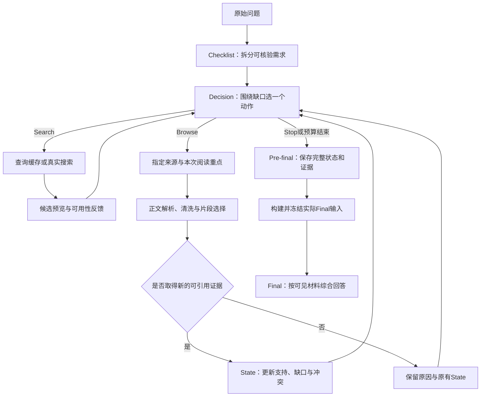

# 工程设计：围绕证据缺口的有界检索流程

[版本三概览](README.md) · [系统与题集](design.md) · [当前源码](current/README.md) · [检索机制](../../docs/retrieval.md)

系统采用一个Process策略循环：模型拆解需求、选择动作和判断支持程度，程序负责执行工具、限制预算、保持来源身份并保存可核验记录。这样的分工让小模型把生成集中在当步决策上，让检索、证据整理和答案综合各有明确输入与输出。

这里说明当前实现的运行机制与适用限制。具体实验的运行身份由各实验页及其源码清单登记；下列设计说明不改写逐题记录。

## 一条问题的完整路径

LangGraph管理节点和路由；ReAct描述“决策—工具—观察—再决策”的循环；MCP是工具执行边界。每次模型请求由程序显式构建上下文，不依赖服务端隐式聊天记忆。

## 1. Checklist：把原问题变成可核验需求

Checklist接收原始问题，提出需要分别核实的内容。程序分配稳定的`R1`、`R2`等需求ID，保留主体、比较对象、时间或其他共享限定。通常拆成少量需求，结构合同最多允许8项，避免把一个问题无限分解成细碎子任务。

需求ID用于绑定后续Search、Browse和State，使每一步可以回答“这次操作准备填补哪个缺口”。原题仍保留在后续请求中，Checklist不会替代原题。

**适用限制：** 程序能检查列表、ID和字段，需求是否忠实、是否遗漏原题重点仍需要模型判断。拆解数量更多不代表覆盖更好；过度拆解和改变主体均属于内容问题。

源码：[节点](current/runtime/src/trainable_agent/engine.py) · [结构合同](current/runtime/src/trainable_agent/contracts.py) · [阶段提示](current/runtime/src/trainable_agent/prompts.py)

## 2. Decision：一次选择一个可执行动作

Decision读取原题、Checklist、最新State、候选、证据索引、最近有效Browse正文、历史反馈与剩余预算，输出一个`Search`、`Browse`或`Stop`。Search和Browse各绑定1–2个需求，便于检查本次意图与后续支持关系。

模型负责选渠道、改写query、选来源和确定阅读重点。程序核验动作结构、需求绑定、来源可见性与预算，并把可恢复的动作不可用原因反馈给下一次决策。输出合同与400-token阶段预算共同约束动作描述的规模。

**适用限制：** 合法动作仍可能没有信息收益。程序保留重复提示、执行反馈和停止理由，让无效选择可被观察；结构检查不能替模型决定哪篇文献最有用。

源码：[Decision与Execute](current/runtime/src/trainable_agent/engine.py) · [动作验证及反馈](current/runtime/src/trainable_agent/contracts.py)

## 3. Search：发现来源，管理新旧候选

论文路径查询PubMed和Semantic Scholar，网页路径使用Serper。Search提供标题、摘要或snippet及来源元数据，主要用于发现和选源。相关性排序同时考虑原问题和本次query，采用原题0.6、query 0.4的组合，兼顾整体任务和当步缺口。

新查询优先展示最新候选，再由历史候选按原题相关性补位，可见集合最多8项。这样既给新方向保留位置，也允许重新使用此前发现的相关来源。组装后按阅读可用性分组：未读优先，部分已读后置，明确当前条件不可用的来源按作用域隐藏；来源历史及稳定别名保留。

**适用限制：** 搜索预览只是相关性线索，不自动登记为已打开证据。搜索没有结果，也不能据此推断某项研究或医学关联不存在。语义排序模型不可用时记录实际降级，不能把降级描述为已完成语义重排。

源码：[工具桥接](current/runtime/src/trainable_agent/tools.py) · [候选更新](current/runtime/src/trainable_agent/engine.py) · [论文发现与融合](current/runtime/retrieval_snapshot_v2/backend/agent/dr_agent/mcp_backend/apis/dual_paper.py)

## 4. 重复Search：复用回执，保留动作成本

同题、同工具身份、同channel和规范化后完全相同的query，复用本题已完成的正常或空回执。缓存返回只重显对应Search的候选，不混入其他query，也不联网补满数量；回执明确标注`cache_hit`与`network_executed`。

重复动作仍计入正常工具预算。缓存因此同时承担两件事：减少重复外部请求，并保留策略原样重复的可观察成本。相似但不完全相同的query只提供提醒，为有意义的缺口细化保留空间。

**适用限制：** 工程缓存控制网络请求，不能保证模型不再提出重复动作。失败或执行结果未知的请求不会被当成正常缓存；恢复依据不足时需要明确处理，不能悄悄重发为一次“新成功”。

源码：[查询缓存](current/runtime/src/trainable_agent/search_cache.py) · [执行与预算](current/runtime/src/trainable_agent/engine.py)

## 5. Browse与reading_focus：围绕本次缺口读取来源

Browse指定当前可选来源和本次`reading_focus`。它描述“这次希望从该来源找到什么”，用于文档内片段检索与排序。例如同一篇研究可以先读主要疗效，再读安全性；改变阅读重点并不意味着已经发现新证据，实际返回文本才决定是否新增E。

`reading_focus`按每次Browse独立处理，可以沿用也可以更换，不与上次拼接累计。它应保留实体、结局、比较对象和当前缺口，并适配所选来源的语言。

| 长度约束所在层 | 当前含义 |
|---|---|
| 动作结构合同 | `reading_focus`使用通用Text字段，最多1200字符；这是字段合法性上限 |
| 实际检索focus投影 | 在锚点封装/相关性构建时按320个UTF-8字节处理；超出部分不进入该投影 |
| 原题检索锚点 | 单独按640个UTF-8字节处理，帮助检索保持原问题方向 |
| 完整原题与证据正文 | 原题仍在模型节点上下文；证据正文使用自己的片段与token预算，不受上述320/640字节直接限制 |

这些预算让检索意图保持简洁，避免把不断扩张的说明文本全部加入检索和排序输入。UTF-8字节数与字符数不同，中文通常占更多字节，因此关键限定应放在简洁focus中；模型生成长度另由各阶段输出token预算控制。

**适用限制：** 短focus是检索投影，不能承载无限限定。重要实体或比较条件放在末尾时可能超出投影范围，编写focus时应优先表达本次核心缺口。该限制不意味着原始问题只剩640字节，也不意味着Browse只能读取320字节证据。

源码：[Browse合同](current/runtime/src/trainable_agent/contracts.py) · [查询锚点与字节预算](current/runtime/retrieval_snapshot_v2/backend/agent/dr_agent/anchored_query.py)

## 6. 正文解析与清洗：减少模板噪声，保护有内容的短段落

可用HTML、XML、摘要、全文或PDF进入对应解析路线，再进行确定性清洗。导航、版权、技术支持UI、订阅控制等页面内容会占用上下文，却通常不回答医学问题，因此清洗同时检查标题用途和文本形态，保留原因及原文位置。

两条弱标题规则仍保留：`template_heading_and_short_list`与`guideline_heading_and_topic_list`。它们用于识别模板标题下的短目录或主题列表。短临床建议、剂量条目和表格也可能具有相似外观，因此弱规则先检查正文保护：事实陈述、否定或比较、数值单位及阈值、中文指令、可识别表格会优先保留；相邻指南导航分支使用同一保护。

这种“明确模板过滤＋正文特征保护”兼顾上下文控制与信息保留。裸数字或逗号、分号、冒号本身不提供通用豁免，明确的行政控制仍有原过滤顺序；是否以句号结尾也不单独决定一段文本有没有价值。

**适用限制：** 保护识别的是文本形态，不是医学真值或相关性。带事实句式的混合目录可能保留更多，需要后续检索排序和内容审核继续判断；表格只有在解析器实际读出行列后才能保留，未解析的图片内容不会自动变成证据。

源码：[Browse清洗与正文保护](current/runtime/src/trainable_agent/context_processing/browser.py) · [HTML正文解析](current/runtime/src/trainable_agent/context_processing/html_body.py)

## 7. 片段选择、去重与E ID：把读到的原文变成可追溯证据

清洗后的内容进入混合召回与片段排序。关键词召回保留实体和精确词项，向量召回补充表达相近的内容，再由语义重排选择当前重点相关的片段。一次Browse最多返回3个片段，保护可用表头、整行及脚注等结构。

已读窗口与精确片段身份参与去重。同一来源可继续提供不同片段，少量重叠也可用于保留上下文；只有重复原文不能被包装成新的信息收益。新增片段登记E ID，并保留来源ID、chunk ID、原文区间、解析路线与哈希。

**适用限制：** 取到3个片段不表示全文已读完，摘要路线耗尽也不代表全文没有内容。召回和重排不能保证每个片段都适用于原问题，E ID表示已打开且可定位，不自动表示结论成立。

源码：[正文处理](current/runtime/src/trainable_agent/context_processing/browser.py) · [确定性上下文](current/runtime/src/trainable_agent/deterministic_context.py) · [证据登记](current/runtime/src/trainable_agent/engine.py)

## 8. State：逐项记录支持、缺口与冲突

取得新证据后调用State节点，模型结合已打开证据更新相关需求的`missing`、`partial`或`direct`、`evidence_ids`、`gap`与`conflict`。返回delta只写变化项，原记录仍保留，便于定位哪条证据改变了哪项判断。

程序检查R/E ID、证据是否已打开及字段约束，避免未读搜索预览直接成为支持依据。空读或失败会把原因反馈给Decision，并保留当前State，不因“调用过Browse”就强行增加一次支持更新。

**适用限制：** State是模型的工作判断，`direct`不是医学认证，也不保证涵盖原题全部细节。程序可以发现不存在的ID，核心事实反转、适用人群错误和支持强度过度判断仍需内容评价。

源码：[State更新](current/runtime/src/trainable_agent/engine.py) · [Delta校验](current/runtime/src/trainable_agent/contracts.py) · [State上下文](current/runtime/src/trainable_agent/context_processing/pipeline.py)

## 9. Stop、失败与预算：为探索设置可解释终点

模型可以因为证据充分、边际收益下降或没有可读来源而提出Stop。程序同时执行正常动作、环境失败豁免、实际动作和可恢复决策拒绝等独立预算，防止重复操作与错误恢复无限延长。

| 约束 | 当前默认值与目的 |
|---|---|
| 正常工具动作 | 6次；包括缓存及普通无新增动作，使每次选择有成本 |
| 已识别环境失败豁免 | 最多5次；为访问或环境问题保留受限机会 |
| 实际工具动作 | 最多11次；约束总执行规模 |
| 可恢复决策拒绝 | 最多6次；与工具调用预算分开登记 |
| 每次完整模型请求 | soft 12288、hard 15000 tokens，包含输出预留、repair 384和safety 128 |
| 阶段输出 | Checklist 1200、Decision 400、State 1200、Final 2400 tokens |
| 压缩兜底 | 确定性去冗余后按需使用；独立10240-token请求预算、最多12次调用 |

候选可用性按来源、需求、query、解析路线及内容身份等实际条件处理。当前条件下明确不可读或耗尽的候选可从可选集隐藏，历史记录仍保留；不同来源条件可以重新评估。临时故障、已核验同任务PDF续取和执行状态未知各有明确边界。

**适用限制：** 预算结束表示本次有界探索结束，不证明全部需求已经解决。`sufficient`是策略给出的理由，需要与证据覆盖核对；无新E也不能单独证明来源永久耗尽。

源码：[终止与计量](current/runtime/src/trainable_agent/engine.py) · [可用性作用域](current/runtime/src/trainable_agent/contracts.py) · [请求预算](current/runtime/src/trainable_agent/context_processing/pipeline.py) · [执行期限与回执](current/runtime/src/trainable_agent/retrieval_deadlines.py)

## 10. 上下文投影：保留任务骨架，让证据按预算进入请求

ContextBuilder为每个阶段重新构建显式输入。原题、Checklist、State、历史和来源映射承担任务连续性；候选和证据按阶段职责展示，Decision不需要每轮重读全部原文，State与Final则使用各自的已读证据视图。

先采用确定性清洗、去重和有界投影，仍有预算压力时才使用隔离的模型原文抽取。Search候选预览与Browse已读正文分开处理，抽取器不能把预览提升成证据，也不能任意改写任务骨架。原始文本独立保存，用于定位和核验。

**适用限制：** 压缩是预算管理，不能补出来源未提供的内容。不能安全容纳的请求明确留有失败或留置记录；请求满足token预算也不自动等于证据覆盖充分。

源码：[上下文管线](current/runtime/src/trainable_agent/context_processing/pipeline.py) · [抽取合同](current/runtime/src/trainable_agent/context_processing/extraction.py) · [压缩兜底](current/runtime/src/trainable_agent/context_processing/fallback.py)

## 11. Pre-final与Final：区分完整存档和实际交付

Pre-final由程序汇集原题、Checklist、State、已打开证据、来源映射、未解决项、停止原因与历史。完整存档支持审计；同版Final构建器进一步形成实际`MESSAGES`并记录预算与身份，明确答案模块真正看到了哪些材料。

Final根据可见材料综合回答，保留未解决边界并使用证据引用。Process-only模式可在Pre-final结束，完整问答模式继续Final。当前主线采用独立的冻结Base Final角色，Process策略与答案模块的职责明确。

**适用限制：** 只存在于完整存档、没有进入实际Final请求的原文不能按已经交付处理。程序检查答案格式和引用ID存在性，引用是否支持具体结论、内容是否贴合原题仍需单独评价；没有可引用证据时不能编造E ID。

源码：[Pre-final与Final节点](current/runtime/src/trainable_agent/engine.py) · [Final输入投影](current/runtime/src/trainable_agent/context_processing/final_pack.py) · [实际输入冻结入口](current/README.md)

## 12. worker与来源回执：保持中断前后的引用连续

Search发现来源后，Browse通过`source_id`引用它，减少后续请求重复传递整份来源信息。worker内分别维护WEB与论文映射，保留canonical ID以及后端需要的可用元数据；来源显示次序变化不重新命名已有身份。

worker启动时从自身output的`worker_operations`读取已完成Search回执，检查操作目录和身份、结果哈希、非链接边界，再按完成顺序恢复映射。已完成操作或paired Search缓存重放也补注册，保持Search→Browse的引用连续，不增加外部Search。WEB沿用原注册函数的URL/hash校验和公共网页作用域，论文恢复核对原生来源身份、别名和URL。

新鲜WEB Search补注册时合并已有完整metadata，避免公共返回投影覆盖内部检索来源字段。论文保留canonical ID，原生可用字段沿用融合规则，最近一次发现的来源顺序等provenance随回执更新。

**适用限制：** 重启恢复仅使用本地已完成且校验通过的材料，只能恢复回执实际保存的字段。未完成或结果未知的操作不会被推定成功；损坏、不匹配或越界回执拒绝恢复，缺失映射不会触发隐式联网重搜。哈希验证确认材料一致性，不验证网页内容真实。

源码：[worker执行边界](current/runtime/retrieval_snapshot_v2/worker.py) · [来源恢复](current/runtime/retrieval_snapshot_v2/source_registry.py) · [论文Registry](current/runtime/retrieval_snapshot_v2/backend/agent/dr_agent/mcp_backend/apis/dual_paper.py) · [本地操作回执](current/runtime/src/trainable_agent/retrieval_deadlines.py)

## 验证这些边界

正文保护测试覆盖临床短句、剂量、否定比较、中文条目、表格、保留的模板过滤和原文位置。来源恢复测试覆盖真实子进程退出与重启、完成回执及paired缓存、canonical ID、WEB metadata、论文provenance、损坏材料与路径边界。

这些测试核验工程行为；检索相关性、医学支持程度、实际交付覆盖与答案质量在[评测](evaluation.md)和[逐题记录](records.md)中分别报告。原始响应、修复事件、失败尝试和实际交付材料各自留档，保证问题能够追溯到具体阶段。

测试入口：[正文保护](current/runtime/tests/test_short_body_protection.py) · [来源恢复](current/runtime/tests/test_worker_source_registry.py) · [当前源码检查](current/README.md#离线检查)
