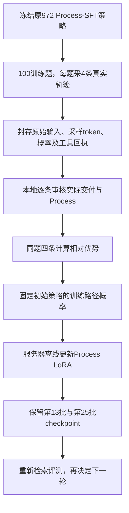

# 4. Process-GRPO：从证据交付奖励到策略更新

[概览](README.md) · [系统与数据](design.md) · [逐步工程设计](engineering.md) · [Process-SFT](process_sft.md) · [Final-SFT](final_sft.md) · **GRPO** · [评测](evaluation.md) · [逐题记录](records.md)

**这条路线先用SFT建立可执行的检索行为，再用同题多条轨迹的相对质量，优化Process实际交付的证据与决策可靠性。** Final保持Base，更新目标集中在模型可以控制的需求拆解、检索选择和State判断。Base、Process-SFT、GRPO13与GRPO25的完整比较见[新100题检验](experiments/newbench_20261028/README.md)。

## 为什么采用Base → SFT → GRPO这条路线

| 层次 | 主要任务 | 在系统中的作用 |
|---|---|---|
| Base | 提供通用语言、医学知识与推理能力 | 作为Process对照及冻结Final生成器 |
| Process-SFT | 学习Checklist、Decision、State的输入输出与工具交互 | 建立可执行、可追溯的检索策略，作为GRPO初始化 |
| Process-GRPO | 在同题多条真实轨迹中提高高质量行为的相对概率 | 把优化信号落到适用证据交付、支持判断、原题覆盖和有效决策 |

SFT说明“合格阶段输出可以怎样写”，GRPO进一步使用实际轨迹差异区分“这次选择带来了什么”。工具、上下文与证据合同由工程控制，策略改进通过相同框架下的重新检索评测检查。这是选择GRPO继续优化Process的设计依据。

本批结果支持的优势是：GRPO保持零完全重复Search，重大或Process失败题数为14/100，少于SFT的17/100和Base的21/100；GRPO25在两个benchmark交付更多适用证据，GRPO13的HealthBench答案加权分最高。这些指标构成继续选择GRPO路线的依据。具体checkpoint仍按交付、错误与答案分别选择，逐题胜负和未占优项在[完整对照](experiments/newbench_20261028/README.md)中保留。

## 一轮训练怎么走



采集、评分、更新分别留有身份与记录。本轮采集400条，审核后99个题组可用、1组工程留置；可用组只遍历一次，共25个更新批次。更新使用封存的实际模型请求和输出，不在优化器循环中调用检索、Final或裁判。

实现入口：[当前Process更新器](current/process_grpo_update/README.md) · [目标函数](current/process_grpo_update/training/process_grpo_update/objective.py) · [固定参数](current/process_grpo_update/training/process_grpo_update/CONFIG.json) · [训练与验收](current/process_grpo_update/training/process_grpo_update/train.py) · [概率和确定性路径](current/process_grpo_update/training/process_grpo_update/runtime.py)。公开源码不附私有轨迹、奖励清单或权重，运行必须绑定自己的合法数据与模型身份。

## 1. 奖励评价什么

**本轮Final权重为0；奖励评价Process真正交给Final的内容和过程可靠性。** Final答案与HealthBench/MedBrowseComp分数用于独立效果检查。

| 分项 | 权重 | 评价对象 |
|---|---:|---|
| P1 实际证据交付 | 40 | 实际Final输入中的证据，是否支持原题必须回答的内容点 |
| P2 State | 30 | 事实理解、证据绑定、支持强度、缺口与冲突是否忠实 |
| P3 Checklist | 20 | 主体、范围与核心需求拆解是否正确 |
| P4 决策 | 10 | 动作是否服务缺口，是否存在无收益重复或不当停止 |

同题四条共享由原题与来源确定的内容点。P1看真正进入Final请求的材料，完整存档中未交付的原文不能补分；链路长短本身不扣分。正确证据已交付而State误读时，P1保留信息收益，P2处理判断错误。具体尺度、普通错误与重大边界见[评分规则](evaluation.md#process怎么评分)。

```math
P_i=P1_i+P2_i+P3_i+P4_i,\qquad
R_i=\begin{cases}
P_i/100 & \text{正常或普通错误}\\
0.49\,P_i/100 & \text{未纠正的重大非致命错误}\\
0 & \text{致命错误或明确Process模型失败}\\
\mathrm{null} & \text{工程记录不可信，留置}
\end{cases}
```

重大折扣取消高奖励资格，同时保留轨迹间的质量差异。同根错误只扣最直接的分项；普通引用标签错误、单纯漏更新不会自动升级为重大。Final-only失败也不会自动把Process奖励置0。

## 2. 同题四条如何转成优势

每题的四条奖励先求均值，再计算每条相对该均值的差：

```math
\bar R_q=\frac14\sum_{j=1}^{4}R_{q,j},\qquad
A_{q,i}=R_{q,i}-\bar R_q.
```

例如同题奖励为`0.8、0.6、0.4、0.2`，均值为`0.5`，优势为`+0.3、+0.1、−0.1、−0.3`。更新提高相对较好轨迹的策略token概率，降低相对较差轨迹的概率。不同题不会因为原始分数高低直接互相排序。

本轮不除组内标准差，避免把只有很小质量差的题组强行放大到统一优势尺度。四条相等时优势为0；出现任一`null`则整题组留置，保持四条比较完整。普通模型失败保留R=0及真实已采样token，仍可提供负向相对信号。

**尺度边界：** 同题中心化减少题目难度对比较的混入，但不使所有题的奖励差距完全一致。题组等权仍保留优势幅度；若某题四条差异更大，其更新信号也可能更强。重大轨迹若仍高于本题均值，可以得到正优势，程序不另行伪造一个负值。

## 3. 哪些token参与更新，Checklist能否学到

Checklist、Decision、State的实际采样输出均属于Process策略token。被拒的JSON尝试和程序修正前的原始输出也保留，避免只挑最后一次合格输出。程序生成的修正文本不冒充模型采样目标。

| 内容 | 在本轮目标中的处理 |
|---|---|
| Checklist / Decision / State原始采样token | 参与Process策略目标 |
| 原题、系统提示、已有状态、工具Observation | 作为条件输入，不计算这些输入token的目标loss |
| 压缩输出、程序Pre-final | 不作为Process策略输出目标 |
| Final答案 | 不更新；Base Final冻结 |

因此Checklist可以得到学习信号。当前采用**一个轨迹优势共享给该轨迹全部Process阶段**，没有给某一步额外编造独立优势。逐步记录用于定位错误；终局奖励可以评价整条轨迹，但不能据此声称已识别某一步的因果贡献。输入不计目标loss也不表示模型看不到输入，输出概率仍以完整当步输入为条件。

## 4. 三种概率各自负责什么

生成使用KV缓存，训练反向使用完整序列前向。量化、矩阵形状和计算路径可能让同一权重下的token概率出现数值差异。系统分别保存三种logprob，避免把计算路径差异混同于策略更新。

| 记号 | 含义 | 是否随本轮更新变化 |
|---|---|---|
| `b_t` | 实际采集时，生成路径对真实采样token的行为logprob | 冻结，保持原始回执 |
| `o_t` | 初始策略在本次已绑定训练环境中、任何更新前完整前向重算的logprob | 单独保存并冻结 |
| `c_t` | 当前Process参数在同一训练路径下计算的logprob | 随LoRA更新变化 |

`o`是本轮初始策略的概率参考，不是额外加载的KL参考模型。所有题组的`o`先准备完成，再进入正式更新；恢复时仍使用同一份已封存参考，不能拿恢复后的当前策略重算并替换它。

## 5. 如何校正生成与训练路径的差异

先计算从行为路径到初始训练路径的token权重，再计算当前训练策略相对初始训练策略的更新比率：

```math
w_t=\operatorname{stopgrad}\!\left(\min\{\exp(o_t-b_t),2\}\right),
\qquad
\rho_t=\exp(c_t-o_t).
```

```math
\ell_{q,i,t}=-w_t\min\!\left(
\rho_t A_{q,i},\ \operatorname{clip}(\rho_t,0.8,1.2)A_{q,i}
\right).
```

- **`w`处理路径差异：** 保留真实行为概率，使用初始训练路径与它的比值作为校正权重；权重停止梯度，上限2控制极端token的影响。
- **`rho`处理策略变化：** 当前策略和冻结初始策略使用相同训练路径。未更新时应为1，更新后再由PPO式clip限制过大的相对变化。
- **两者职责分开：** 未触及上限且不考虑clip时，`exp(o−b)×exp(c−o)=exp(c−b)`；拆开后可以分别检查数值路径与参数变化。

例如同一个token的`o−b=0.05`，其校正权重约为`1.051`；未更新时`rho=1`。这里没有把原始`b`改成`o`，也没有把真实概率差强制写成0。算法处理的是差异对更新的影响，不宣称两条执行路径已经数值完全相同。

**近似边界：** 截断重要性权重用于限制方差，会引入受控偏差；这不是无偏性证明。数据来自固定行为策略，本轮只做一次封存数据更新，属于适配多节点真实轨迹的GRPO风格离线更新；不等同于所有标准库的默认on-policy训练循环。

## 6. 如何避免长轨迹自动拥有更大训练权重

设本批包含`|B|`题，每题4条，轨迹`(q,i)`共有`N_{q,i}`个Process策略token：

```math
L=\frac{1}{|B|}\sum_{q\in B}\frac14\sum_{i=1}^{4}
\frac{1}{N_{q,i}}\sum_{t=1}^{N_{q,i}}\ell_{q,i,t}.
```

先对一条轨迹的全部策略token取均值，再对四条rollout和本批题组等权平均。多次Decision、长State或多次修正不会仅凭token数量自动压过短而有效的轨迹。每次调用仍按真实序列重新前向，分批累计梯度；分母使用该轨迹全部原始采样token总数。

本轮`beta=0`，没有额外KL项。局部clip和小学习率共同约束一次更新的幅度，但不替代跨轮重新采集与独立评测。组内优势有正有负，平均loss接近0并不代表没有梯度；梯度、参数变化和评测结果分别核验。

## 7. 数值路径如何验收

数值检查分成三个独立层面，各自有明确条件：

| 检查 | 目的与门控 |
|---|---|
| 行为概率 ↔ 同路径缓存重放 | 核验原始token、采样参数和记录是否一致；最大logprob差须≤1e−4 |
| 初始训练参考 ↔ 带梯度前向 | 在任何更新前核验相同训练路径；最大差须≤1e−4 |
| 校正权重分布 | 截帽token比例≤5%，截帽后ESS比例≥0.8；质量不足则停止进入更新 |
| 反向与参数范围 | 504个LoRA张量有有限梯度；冻结基座及输出头没有梯度 |
| 保存→恢复→相同下一批 | 同时比较adapter、loss和optimizer状态，保存诊断值后再判定 |

ESS比例用`(Σw)²/(NΣw²)`计算，衡量权重是否集中在少数token。生成路径与完整前向的局部logprob差曾达到约0.03–0.11；冻结FP32 Process输出头改善部分误差，剩余差异通过上述校正与分布门控处理。实际生成参数固定并登记为`temperature=1、top_p=1、top_k=0、单beam、repetition_penalty=1`，明确核验生效配置。

非确定性反向在相同前向loss下可能给出约`1.4×10⁻⁶`的adapter差异；固定相同梯度的AdamW结果可完全一致。当前训练执行路径在CUDA初始化前设置`CUBLAS_WORKSPACE_CONFIG=:4096:8`，启用严格确定性算法、关闭cuDNN benchmark、TF32和dropout，并固定依赖版本。完整8题32条保存恢复验收中，adapter差与loss差均为0，optimizer精确匹配。

**验收边界：** 这些结论绑定已登记的模型、软件、设备和执行配置，不承诺任意CUDA硬件都逐位一致。梯度检查点与词表分块计算用于显存管理，真实长输入保持完整；短样本通过不能替代完整多阶段恢复验收。诊断checkpoint与正式初始化分开，正式更新从原972初始化或同一正式输出的完整断点恢复。

## 8. 实际参数、checkpoint与恢复合同

| 项目 | 本轮执行配置 |
|---|---|
| 初始化 | 原972 checkpoint1322 Process LoRA |
| 训练数据 | 99个可用题组，4条/题；另外1组工程留置 |
| 数据遍历 | 单次遍历，seed42固定打乱，25个更新批次 |
| 每批 | 最多4题、16条rollout；末批3题，按实际题数归一 |
| optimizer | AdamW；betas=(0.9,0.999)，eps=1e−8，weight_decay=0 |
| LR / 梯度裁剪 | 1e−6；max_grad_norm=1 |
| PPO clip / IS cap | epsilon=0.2；IS上限2 |
| 组内信号 / KL | reward减同题四条均值，不除标准差；beta=0 |
| 基座与参数 | Qwen3-8B NF4双重量化、BF16计算；504个FP32 Process LoRA张量参与更新 |
| 输出头 / Final | 未合并FP32 Process线性输出头冻结；Final禁用adapter并恢复原输出头 |
| 显存管理 | 梯度检查点；logit每8个策略token分块计算 |
| checkpoint | 第13批中途、第25批完成；不是13轮或25轮 |

GRPO13表示完成前13个更新批次，即固定顺序中的前52个可用题组；GRPO25完成全部99组。checkpoint选择通过各自重新检索后的证据交付、错误、重复行为与答案指标判断，不以“用完全部题”自动认定最终checkpoint最优。

断点包含adapter、optimizer、批次、配置、环境和参考概率身份。已封存批次跳过；处理中断的部分梯度丢弃，完整断点之后的批次重新计算。未完成目录不当成成功，恢复不得重复计算已完成更新，也不得更换奖励或初始概率参考。

正式完成记录为`completed_batches=25、checkpoint-0025`。最后一批144次Process调用、12571个策略token，梯度范数0.0580，clipped_fraction约0.000477，初始路径对齐最大误差0。这些是执行状态指标，内容收益由[四组评测](evaluation.md)核验。

## 后续设计：先固定结论边界，再决定新一轮

1. 新100题四组同配置检验已完成：GRPO保持零完全重复Search，GRPO25作为Process交付/可靠性主候选，GRPO13保留为HealthBench答案指标对照。逐题胜负及失败并非全部优于SFT，见[新增检验](experiments/newbench_20261028/README.md)。下一轮采集/训练未启动。
2. 优先定位State的实体/单位/方向误读、证据错绑、否认已交付核心信息，以及Checklist重大偏题。已有40/30/20/10规则先冻结，不因希望某个模型胜出而事后调权重。
3. 若开展下一轮更新，从明确选定的新策略重新采集同题组内轨迹，本地审核再提交服务器；训练题与独立验证题隔离，不无限重复首批400条当新策略数据。
4. 先保留单个终局Process奖励、整轨迹优势这一简单方案。逐步记录错误用于诊断；逐步奖励、不同权重、KL或优势归一化如要比较，另立单变量实验，不写成已实现。
5. Final继续使用固定Base。Final-SFT若重启，先修有证据的数据/错误模式并单独验证，不能为了延续流程而默认替换掉当前更好的生成器。

尚未确定下一轮题数、训练轮数或新参数；此页不自动发起采集、评分或训练。

## 本轮尚未实现什么

没有做逐步优势分配、Final-only奖励消融、额外KL参考项或后续新策略数据轮次。逐步问题记录用于诊断，同一轨迹的Checklist、Decision和State token目前共享一个终局优势；不能宣称已经识别每一步的因果贡献。

早期BF16优先、leave-one-out与Final-only候选保存在[历史算法计划](archive/grpo_initial_plan.md)，不与本轮公式混用。下一轮题数和新参数尚未冻结，不自动提交训练。

**下一章：[评测方法与四组结果](evaluation.md)。**
