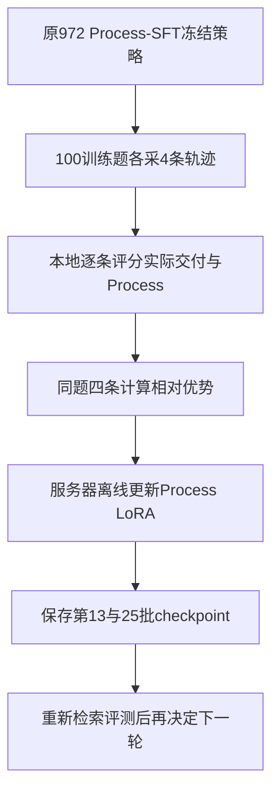

# 4. Process-GRPO：采集、奖励与更新

[概览](README.md) · [系统与数据](design.md) · [Process-SFT](process_sft.md) · [Final-SFT](final_sft.md) · **GRPO** · [评测](evaluation.md) · [逐题记录](records.md)

## 一轮训练怎么走



采集、评分和更新是三个独立步骤。本轮先采完400条，再本地审核，最后一次遍历99个可用题组；没有在服务器边跑工具边用即时Final分更新。

## 奖励到底来自哪里

**本轮Final权重为0；奖励评价Process真正交给Final的内容和过程可靠性。** P1覆盖40分、P2 State30分、P3 Checklist20分、P4决策10分。普通轨迹R=P/100；未纠正重大错误R=0.49×P/100；致命/明确Process模型失败R=0；工程留置R=null。逐项标准与例子见[评分规则](evaluation.md#process怎么评分)。

同题四条共享内容点与尺度。Final答案和HealthBench分作为独立诊断，不进入这轮训练奖励；不能把“冻结Final”理解为其分数必然应该给Process。

## 数据、初始化和训练边界

100题×4个rollout，400条完整记录；99组可用、1组工程留置。初始策略是原972 Process-SFT checkpoint1322，不是从未微调Base直接开始。100题与旧HealthBench50的ID/规范化文本重叠为0；不据此排除语义相关或预训练污染。

量化基座为Qwen3-8B NF4双重量化、BF16计算。仅更新原Process LoRA的504个FP32张量；输出头以未合并FP32线性计算并冻结。Final/Reader禁用adapter、恢复原输出头。本轮离线更新不运行检索、Final或裁判，使用封存真实阶段输入、token和已审核奖励。

Checklist、Decision、State的原始采样attempt均可进入策略目标，包括被拒JSON及程序修正前原文；输入、工具Observation、压缩输出、程序Pre-final和Final token全部mask。同一轨迹共享一个优势，不宣称已做逐步信用分配。

## 同题优势

```math
A_i=R_i-\frac{1}{4}\sum_{j=1}^{4}R_j.
```

不除组内标准差，不在不同题之间直接比较奖励大小。四条相等时优势为0；任一条工程留置null，则整组不更新。普通模型失败保留R=0及真实策略token。重大轨迹若仍高于同题均值也可能正优势，不人为强制负值。

## 分开保存行为概率与训练路径概率

b为采集时真实采样token的logprob；o为本次初始权重在训练执行路径、任何更新前重新计算的logprob；c为当前更新中logprob。

```math
w_t=\mathrm{stopgrad}\!\left(\min\{\exp(o_t-b_t),2\}\right),\qquad
\rho_t=\exp(c_t-o_t).
```

```math
\ell_t=-w_t\min\!\left(\rho_t A_i,\mathrm{clip}(\rho_t,0.8,1.2)A_i\right).
```

初始未更新时要求训练路径ratio=1；w保留采集与训练计算路径差异的校正，不篡改采集概率，不声称概率差异已经消失。每条轨迹先对其全部Process策略token取均值，再对四条rollout及本批题组等权平均，避免长链路自动获得更大权重。本轮beta=0，无额外KL参考模型项；属于适配封存多节点轨迹的GRPO风格离线更新，不等同于所有标准库默认实现。

## 实际参数和完成状态

| 项目 | 本轮执行配置 |
|---|---|
| 初始化 | 原972 checkpoint1322 Process LoRA |
| 训练数据 | 99个可用题组，4条/题；另外1组留置 |
| 数据遍历 | 单次遍历，25个更新批次 |
| 每批 | 最多4题、16条rollout；末批按实际题数归一 |
| optimizer / LR | AdamW；1e-6；max_grad_norm=1 |
| clip / IS cap | epsilon=0.2；IS上限2 |
| 信号 | reward减同题四条均值，不除标准差 |
| 精度 | NF4/BF16基座、FP32 LoRA与冻结FP32 Process输出头 |
| 确定性 | 关闭dropout，确定性算法，CUBLAS_WORKSPACE_CONFIG=:4096:8 |
| 显存 | 梯度检查点，词表分块计算；不截断真实输入来通过验收 |
| checkpoint | 第13批中途、25批完成；不是13轮/25轮 |

正式完成记录为completed_batches=25、checkpoint-0025。最后一批144次Process调用、12571个策略token，梯度范数0.0580，clipped_fraction约0.000477，初始路径对齐最大误差0；单批指标不构成整体效果证明。

## 数值验收与恢复

早期NF4采样缓存路径与完整前向有约0.03–0.11的局部logprob差；FP32输出头只能减小部分误差，未完全消除。后续保存行为概率、缓存重放和训练路径概率，分离校正权重与更新ratio，并验证真实非空State的反向。

原始非确定性模式曾在相同loss下产生约1.4e-6的adapter差异；固定梯度的优化器更新可完全一致，定位到反向非确定性。启用确定性修正后，完整8题32条的保存恢复验收中adapter差、loss差均0，optimizer精确匹配，才开始正式更新。

训练曾因磁盘配额不足中断；保留验收和最后完整断点、清理旧权重后续训，最终完成25批。部分写入目录不当作成功，已完成批次不重复训练；该磁盘故障不是模型质量失败。

本轮只完成这一批封存数据的一次更新实验。下一轮若改变策略，需要重新采集当前策略轨迹并冻结新奖励身份，不能无限复用这400条冒充新on-policy数据。

## 后续设计：先固定结论边界，再决定新一轮

1. 新100题四组同配置检验已完成：GRPO保持零完全重复Search，GRPO25作为Process交付/可靠性主候选，GRPO13保留为HealthBench答案指标对照。逐题胜负及失败并非全部优于SFT，见[新增检验](experiments/newbench_20261028/README.md)。下一轮采集/训练未启动。
2. 优先定位State的实体/单位/方向误读、证据错绑、否认已交付核心信息，以及Checklist重大偏题。已有40/30/20/10规则先冻结，不因希望某个模型胜出而事后调权重。
3. 若开展下一轮更新，从明确选定的新策略重新采集同题组内轨迹，本地审核再提交服务器；训练题与独立验证题隔离，不无限重复首批400条当新策略数据。
4. 先保留单个终局Process奖励、整轨迹优势这一简单方案。逐步记录错误用于诊断；逐步奖励、不同权重、KL或优势归一化如要比较，另立单变量实验，不写成已实现。
5. Final继续使用固定Base。Final-SFT若重启，先修有证据的数据/错误模式并单独验证，不能为了延续流程而默认替换掉当前更好的生成器。

尚未确定下一轮题数、训练轮数或新参数；此页不自动发起采集、评分或训练。


## 本轮尚未实现什么

没有做逐步优势分配、Final-only奖励消融、额外KL参考项或后续新策略数据轮次。逐步问题记录用于诊断，同一轨迹的Checklist、Decision和State token目前共享一个终局优势；不能宣称已经识别每一步的因果贡献。

早期BF16优先、leave-one-out与Final-only候选保存在[历史算法计划](archive/grpo_initial_plan.md)，不与本轮公式混用。下一轮题数和新参数尚未冻结，不自动提交训练。

**下一章：[评测方法与四组结果](evaluation.md)。**
